# 非绝热载流子动力学理论计算方法

---

## 阅读导览

本文档围绕**凝聚态体系中载流子(电子-空穴)非绝热弛豫/复合动力学**的理论方法,从 Tully 的 FSSH 出发,经由 Prezhdo 等人引入的 KS 轨道近似与经典路径近似(CPA),最终落到 DISH 退相干修正,并给出 PYXAID 数值实现中需要注意的相位修正问题。读者预期掌握量子力学基础与基本的电子结构概念(KS 轨道、绝热表象等)。

**章节地图**

- **一、FSSH 推导**:核心理论。从含时薛定谔方程出发,推导单态系数演化 $\dot c_k$ → 密度矩阵布居流 $\dot a_{kk}$ → 单步跃迁概率 $g_{k\to j}$ → 速度调整。这是后面所有内容的基础,**建议完整阅读**。
- **二、TDDFT 下的面跳跃**:实用化简化。引入 KS 轨道把多体 NAC 化为单电子积分(Slater 行列式简化)、CPA 替代核轨迹分支(配合玻尔兹曼因子)、DISH 显式引入退相干(随机演化算符 + 退相干时间)。**做 PYXAID 计算请阅读读 §2.2 和 §2.3**。
- **三、结论**:对 FSSH 局限性的小结。
- **四、PYXAID 设置**:实用参数手册;按 Python 字典对需要用到的关键词 `params[...]` 含义解释。**做实操时可以对照本章**。
- **五、相位修正**:数值实现细节。VASP 每个离子步对角化得到的相位是随机的,直接套 (57) 会引入虚部噪声;给出脚本中的修正算法。
- **六、全电子校正**:占位,待补。
- **七、附录:量子力学基础**:波函数、算符、测量、薛定谔方程、全同粒子假设。建议作为查阅参考,不必顺读。

**按目的的阅读路径**

- **第一次接触 FSSH,想完整把推导走一遍**:§1 → §2 → §3,公式编号 (1)–(57)。
- **只想跑 PYXAID 出载流子寿命**:§2.2(CPA 与玻尔兹曼修正)→ §2.3(DISH 的物理图像,公式略读)→ §4(参数)→ §5(相位修正,理解为什么必须做)。
- **写文章引用,要规范的数学形式**:§1.4 公式 (16)、§1.5 公式 (35)(36)(37)、§1.6 公式 (42)(44)、§2.1 公式 (57) 是常被引用的关键式;参考文献见末尾。

**数学符号约定**

| 符号 | 含义 |
|:---|:---|
| $\Psi(r,R,t)$ | 总电子波函数 |
| $\phi_i(r;R)$ | 绝热基函数(多电子) |
| $\varphi_p(r)$ | KS 单电子轨道 |
| $c_i(t)$ | 展开系数 |
| $a_{kj}=c_k c_j^*$ | 密度矩阵元;对角元 $a_{kk}=\lvert c_k\rvert^2$ 为布居数 |
| $V_{kj}=\langle\phi_k\rvert H_0\lvert\phi_j\rangle$ | 电子哈密顿量矩阵元;绝热基下非对角为 0 |
| $\mathbf d_{kj}=\langle\phi_k\rvert\nabla_{\mathbf R}\lvert\phi_j\rangle$ | 非绝热耦合矢(NAC) |
| $\dot{\mathbf R}$, $\mathbf v$ | 核速度 |
| $b_{kl}$ | $\dot a_{kk}=\sum_l b_{kl}$ 定义的布居流 |
| $g_{k\to j}$ | 单步从 $k$ 跃迁到 $j$ 的概率 |
| $\tau_k$ | 态 $k$ 的退相干时间 |

---

## 目录

- [非绝热载流子动力学理论计算方法](#非绝热载流子动力学理论计算方法)
  - [阅读导览](#阅读导览)
  - [目录](#目录)
  - [一、最小面跳跃(Fewest-Switches Surface Hopping, FSSH)主要推导过程](#一最小面跳跃fewest-switches-surface-hopping-fssh主要推导过程)
    - [1、哈密顿量](#1哈密顿量)
    - [2、含时薛定谔方程及电子波函数展开](#2含时薛定谔方程及电子波函数展开)
    - [3、投影](#3投影)
    - [4、处理展开式](#4处理展开式)
    - [5、引入密度矩阵](#5引入密度矩阵)
    - [6、如何发生跃迁](#6如何发生跃迁)
      - [6.1 N 条轨迹](#61-n-条轨迹)
      - [6.2 判断是否跃迁的随机算法](#62-判断是否跃迁的随机算法)
      - [6.3 能量守恒与速度调整](#63-能量守恒与速度调整)
  - [二、含时密度泛函理论下的面跳跃](#二含时密度泛函理论下的面跳跃)
    - [1、KS 轨道近似](#1ks-轨道近似)
    - [2、经典路径近似(Classical Path Approximation, CPA)](#2经典路径近似classical-path-approximation-cpa)
    - [3、量子退相干修正](#3量子退相干修正)
      - [3.1 随机演化算符](#31-随机演化算符)
      - [3.2 退相干时间](#32-退相干时间)
      - [3.3 随机判断退相干事件](#33-随机判断退相干事件)
  - [三、结论](#三结论)
  - [四、PYXAID 设置](#四pyxaid-设置)
  - [五、相位修正](#五相位修正)
  - [六、全电子校正](#六全电子校正)
  - [七、附录:所需量子力学基础](#七附录所需量子力学基础)
    - [1、波函数假设](#1波函数假设)
      - [1.1 量子系统的状态描述](#11-量子系统的状态描述)
      - [1.2 统计诠释](#12-统计诠释)
      - [1.3 归一化条件](#13-归一化条件)
    - [2、算符假设](#2算符假设)
      - [2.1 每个可观测量对应一个厄米算符](#21-每个可观测量对应一个厄米算符)
      - [2.2 本征值方程](#22-本征值方程)
    - [3、测量假设](#3测量假设)
    - [4、薛定谔方程](#4薛定谔方程)
      - [4.1 含时薛定谔方程](#41-含时薛定谔方程)
      - [4.2 定态薛定谔方程](#42-定态薛定谔方程)
    - [5、全同粒子假设](#5全同粒子假设)
      - [5.1 交换对称性](#51-交换对称性)
      - [5.2 泡利不相容原理](#52-泡利不相容原理)
- [参考文献](#参考文献)

---

## 一、最小面跳跃(Fewest-Switches Surface Hopping, FSSH)主要推导过程

### 1、哈密顿量

首先定义系统的总哈密顿量 $H$：

$$
H = T_R + H_0(r, R) \tag{1}
$$

其中:

- $r$ 代表电子坐标。
- $R$ 代表原子核坐标。
- $H_0(r, R)$ 是原子核固定在位置 $R$ 时的电子哈密顿量(包含电子动能 $T_e$、电子-电子势能 $V_{ee}$、电子-核势能 $V_{ne}$、核-核势能 $V_{nn}$)。
- $T_R$ 代表了原子核动能部分。由于电子动能是在固定核位置 $R(t)$ 的瞬时情况下求解,原子核的运动由经典轨迹 $R(t)$ 描述,即在电子提供的势能面上经典运动(玻恩-奥本海默近似)。但在后续的非绝热耦合项中会出现核速度,因此核动能的影响已经通过非绝热耦合项包含,而不是显式的 $T_R$。
- 由于原子核动能可以被精确求解,因此将原子核动能提出,其他项作为哈密顿量 $H$ 的微扰项处理。需要注意的是,虽然核势能仅依赖核坐标、求解时被视为常数,但它会影响电子态的能量,因此包含在电子哈密顿量中。

---

### 2、含时薛定谔方程及电子波函数展开

原子核的运动由经典轨迹 $R(t)$ 描述。因此,电子波函数 $\psi(r, R, t)$ 需要满足含时薛定谔方程:

$$
i\hbar \frac{\partial \psi}{\partial t} = H_0(r, R(t)) \psi \tag{2}
$$

此时,原子核坐标 $R$ 是时间 $t$ 的函数 $R(t)$。选择一组**正交归一**的电子基函数 $\phi_j(r; R)$ 来展开总的电子波函数 $\psi$,通常是绝热基函数(此处的展开使用了经典近似,将原子核轨迹当作经典处理,因为原子核的量子波函数特征丢失了,只剩下沿着轨迹演化的展开系数):

$$
\Psi(r,R,t)=\sum_{i}c_{i}(t)\phi_{i}(r;R(t)) \tag{3}
$$

其中:

- $\phi_i(r;R(t))$:是基函数。基函数负责"形状",即电子云应该长什么样;但基函数包含了 $R(t)$,当原子核移动时基函数的形状也随之改变,所以基函数通过原子核轨迹隐式地依赖于时间。
- $c_i(t)$:是展开系数。模方 $|c_i(t)|^2$ 代表系统处于第 $i$ 个状态的概率($c_i(t)$ 是复数,包含实部和虚部)。展开系数负责时间演化,其中包含了时间相位,即 $e^{-i\int E\,dt/\hbar}$(详见**相位修正**部分)。
- 物理意义:将复杂的波函数 $\Psi$ 转化为了寻找一组展开系数 $c_i(t)$ 随时间变化的问题。

> **说明**:
>
> - 表象本质上是基函数的选择,是对同一个东西的不同表示。
> - 直角坐标系(直角坐标系表象):用 $(x, y, z)$ 三个数字来描述一个矢量。
> - 球坐标系(球坐标系表象):用 $(r, \theta, \phi)$ 三个数字来描述同一个矢量。
> - 虽然给出的基函数 $(x, y, z)$ 和 $(r, \theta, \phi)$ 不同,但是可以表示的是相同的量。
> - 在非绝热动力学中,**绝热表象**(Adiabatic Representation)和**透热表象**(Diabatic Representation)是主要选择的两种基函数。
> - 一般第一性原理计算软件均采用绝热基函数,计算出的 HOMO、LUMO、势能面、能级等均是基于绝热表象定义的。且哈密顿量的对角项即为本征能量,因此物理图像直观。透热基的哈密顿量矩阵不再是对角的,转换较繁琐,这里不过多涉及。

将展开式 (3) 带入含时薛定谔方程 (2) 中,左边可得:

$$
i\hbar \frac{\partial}{\partial t} \left( \sum_j c_j(t) \phi_j(r; R(t)) \right) = i\hbar \sum_j \left[ \frac{\partial c_j}{\partial t} \phi_j + c_j \frac{\partial \phi_j}{\partial t} \right] \tag{4}
$$

> **说明**:此处使用莱布尼茨法则 $\dfrac{d}{dx}[f(x)g(x)] = f'(x)g(x) + f(x)g'(x)$。

由于 $\phi_j(r; R(t))$ 不显含时间 $t$,但核位置 $R(t)$ 含时,因此 $\phi_j(r;R(t))$ 对时间的导数需要使用链式法则处理。

> **说明**:
>
> - 链式法则:$\dfrac{df(g(x))}{dx} = \dfrac{df}{dg} \cdot \dfrac{dg}{dx}$。
> - 为什么 $\phi_j(r; R(t))$ 中电子坐标不含时间 $t$:对电子需要使用量子力学处理,如果说 $t$ 时刻电子的位置为 $r$,这样描述的电子为经典力学描述。因此,我们只能描述为在 $t$ 时刻,电子在空间中任意一点 $r$ 出现的概率幅是多少。
> - 因此,对基函数 $\phi_j(r; R(t))$ 的定义也可以写作:原子核在 $R$ 位置时,电子云 $r$ 的形状是什么样的。在这个定义中不包含 $t$,因为我们只是根据原子核不同位置计算出电子云的形状。所以电子坐标不含时间 $t$。

展开式 (4) 可以写作:

$$
i\hbar \frac{\partial}{\partial t} \left( \sum_j c_j(t) \phi_j(r; R(t)) \right) = i\hbar \sum_j \left[ \frac{\partial c_j}{\partial t} \phi_j + c_j \nabla_{\mathbf R}\phi_j \cdot \dot{\mathbf R} \right] \tag{5}
$$

其中:

- $\dfrac{\partial \mathbf R}{\partial t}$ 为核速度,即 $\dot{\mathbf R}$。
- $\dfrac{\partial \phi_j}{\partial \mathbf R}$ 为波函数对核坐标的求导,一般写作核坐标梯度算子 $\nabla_{\mathbf R}$。
- $\dfrac{\partial c_j}{\partial t}$ 一般写作 $\dot{c}_j$,代表概率幅的变化率。

所以整体的展开可以写作:

$$
i\hbar \sum_j \left[ \dot{c}_j \phi_j + c_j \dot{\mathbf R} \cdot \nabla_{\mathbf R}\phi_j \right] = \sum_j c_j H_0 \phi_j \tag{6}
$$

---

### 3、投影

上面得到的为一般情况的式子,但是我们一般不关心全部态,只关心部分态的变化,因此需要对某一个态 $k$ 进行投影,得到态 $k$ 的系数变化率 $\dot{c}_k$。

> **说明**:
>
> - 目前我们的方程中包含了全部的电子态($1, 2, 3, \dots, j$),无法单独算出态 $k$ 的系数是如何变化的。
>
> **例**:
>
> - 对于二维空间的一个向量 $(c_x, c_y)$,两个基函数(基向量)分别是 $\vec{e}_x$ 和 $\vec{e}_y$,向量 $\vec{V}$ 可以写作 $c_x \vec{e}_x + c_y \vec{e}_y$。
> - 如果我们只关心 $\vec{e}_x$ 方向上的变化,即我们只想知道 $c_x$ 是如何变化的,需要用 $\vec{e}_x$ 点乘这个矢量。
> - 此时得到:$\vec{e}_x \cdot \vec{V} = \vec{e}_x \cdot (c_x \vec{e}_x + c_y \vec{e}_y) = c_x (\vec{e}_x \cdot \vec{e}_x) + c_y (\vec{e}_x \cdot \vec{e}_y)$。
> - 基向量自己点乘自己是 1,因此第一项为 $c_x$。由于 $\vec{e}_x$ 和 $\vec{e}_y$ 相互正交,因此第二项为 0,这样我们就利用了基向量的**正交归一性**得到了我们关心的系数 $c_x$。

因此,使用同样的方法,在展开式 (6) 中,左乘 $\phi_k^*(r; R)$ 并对电子坐标 $r$ 积分:

$$
\int \phi_k^* \left\{ i\hbar \sum_j \left[ \dot{c}_j \phi_j + c_j \dot{\mathbf R} \cdot \nabla_{\mathbf R}\phi_j \right] \right\} dr = \int \phi_k^* \sum_j c_j H_0 \phi_j \, dr \tag{7}
$$

> **说明**:后续大部分情况不会再使用积分表达,而使用狄拉克符号,即 $\langle \phi_k |\phi_j \rangle = \int \phi_k^*\phi_j \, dr$。因此均采用下式:

$$
\left\langle \phi_k \,\middle|\, i\hbar \sum_j \left[ \dot{c}_j \phi_j + c_j \dot{\mathbf R} \cdot \nabla_{\mathbf R}\phi_j \right] \right\rangle = \left\langle \phi_k \,\middle|\, \sum_j c_j H_0 \phi_j \right\rangle \tag{8}
$$

根据积分的线性性质,即和的积分等于积分的和:$\int [f(x) + g(x)] dx = \int f(x) dx + \int g(x) dx$,可以将求和符号放在外面,因此展开式 (8) 变为:

$$
i\hbar \sum_j \dot{c}_j \langle \phi_k | \phi_j \rangle + i\hbar \sum_j c_j \langle \phi_k | \nabla_{\mathbf R} | \phi_j \rangle \cdot \dot{\mathbf R} = \sum_j c_j \langle \phi_k | H_0 | \phi_j \rangle \tag{9}
$$

在展开式 (9) 第二项中,由于 $\dot{\mathbf R}$ 为核速度,不包含电子坐标,因此可以放在积分外;并且 $\dot{c}_j$ 是关于时间 $t$ 的函数,对电子坐标积分为常数,也可以提到积分外。

---

### 4、处理展开式

根据前面提到的正交归一性,可以得到 $\langle \phi_k |\phi_j \rangle = \delta_{kj}$:如果 $k=j$,则 $\delta_{kj}$ 为 1;如果 $k\neq j$,则 $\delta_{kj}$ 为 0。

因此展开式 (9) 的第一项仅保留 $k=j$ 时的 $\dot{c}_k$:

$$
i\hbar \dot{c}_k \tag{10}
$$

展开式 (9) 的第二项被定义为**非绝热耦合矢**(Nonadiabatic Coupling Vector, NAC):

$$
\mathbf{d}_{kj}(\mathbf R) = \left\langle \phi_k \,\middle|\, \nabla_{\mathbf R} \,\middle|\, \phi_j \right\rangle, \qquad \dot{\mathbf R}\cdot \mathbf{d}_{kj} = \left\langle \phi_k \,\middle|\, \frac{\partial}{\partial t} \,\middle|\, \phi_j \right\rangle \tag{11}
$$

在之前的推导中使用了链式法则,也可以将其还原回去,即:

$$
D_{kj}(t) \equiv \left\langle \phi_k \,\middle|\, \frac{\partial}{\partial t} \,\middle|\, \phi_j \right\rangle = \dot{\mathbf R}\cdot \mathbf{d}_{kj} \tag{12}
$$

式 (11) 中 $\mathbf{d}_{kj}$ 是对核坐标的非绝热耦合矢量,式 (12) 中 $D_{kj}$ 是沿经典轨迹的时间导数耦合标量。是否显式写出 $\dot{\mathbf R}$ 需要根据推导情况判定。对于使用第一性原理软件和 PYXAID 软件所进行的数值计算来说,一般采用后一种形式更为方便(具体原因见**相位修正**部分)。

> **注意**:在文献中,非绝热耦合更经常写作
>
> $$
> D_{jk}(t) = \dot{\mathbf R}\cdot \mathbf{d}_{jk} = \dot{\mathbf R}\cdot \frac{\langle \phi_j | \nabla_{\mathbf R} \hat{H} | \phi_k \rangle}{\varepsilon_k - \varepsilon_j}
> $$
>
> 推导如下。从定态薛定谔方程出发:
>
> $$
> \hat{H}(r,R) |\phi_k\rangle = \varepsilon_k(R) |\phi_k\rangle
> $$
>
> 其中 $\hat{H}(r,R)$ 是电子哈密顿量,$\varepsilon_k(R)$ 是本征能量,$|\phi_k\rangle$ 是绝热基函数。电子哈密顿量与电子位置和核位置相关,而 $\varepsilon_k(R)$ 对于电子来说是常数(即本征值),但对于原子核来说是关于原子核位置 $R$ 的变量(即势能面)。
>
> 对上式求原子核梯度 $\nabla_{\mathbf{R}}$:
>
> $$
> \nabla_{\mathbf{R}} \left( \hat{H}(r,R) |\phi_k\rangle \right) = \nabla_{\mathbf{R}} \left( \varepsilon_k(R) |\phi_k\rangle \right)
> $$
>
> 应用乘积求导法则:
>
> $$
> (\nabla_{\mathbf{R}} \hat{H}) |\phi_k\rangle + \hat{H} (\nabla_{\mathbf{R}} |\phi_k\rangle) = (\nabla_{\mathbf{R}} \varepsilon_k) |\phi_k\rangle + \varepsilon_k (\nabla_{\mathbf{R}} |\phi_k\rangle)
> $$
>
> 对上式左乘另一个态 $\langle \phi_j|$:
>
> $$
> \langle \phi_j | (\nabla \hat{H}) | \phi_k \rangle + \langle \phi_j | \hat{H} | \nabla \phi_k \rangle = \langle \phi_j | (\nabla \varepsilon_k) | \phi_k \rangle + \varepsilon_k \langle \phi_j | \nabla \phi_k \rangle
> $$
>
> - **第二项化简**:哈密顿量是厄米的,即对哈密顿量取复共轭再取转置后等于本身,因此左侧第二项可以写作 $\langle \phi_j | \hat{H} | \nabla \phi_k \rangle = \varepsilon_j \langle \phi_j | \nabla \phi_k \rangle$。
> - **第三项化简**:$\nabla \varepsilon_k$ 对于电子积分来说是常数(因为本征能量 $\varepsilon_k(\mathbf{R}) = \langle \phi_k | \hat{H}_{el} | \phi_k \rangle$ 已经对电子全空间积分完毕,只依赖于核坐标 $R$),因此可以提出;根据正交性 $\langle \phi_j | \phi_k \rangle = 0$($j \neq k$),这一项为 0。
>
> 化简后:
>
> $$
> \langle \phi_j | \nabla \hat{H} | \phi_k \rangle + \varepsilon_j \langle \phi_j | \nabla \phi_k \rangle = \varepsilon_k \langle \phi_j | \nabla \phi_k \rangle
> $$
>
> 整理可得:
>
> $$
> (\varepsilon_k - \varepsilon_j) \langle \phi_j | \nabla \phi_k \rangle = \langle \phi_j | \nabla \hat{H} | \phi_k \rangle
> $$
>
> 即:
>
> $$
> \mathbf{d}_{jk} = \langle \phi_j | \nabla_{\mathbf{R}} \phi_k \rangle = \frac{\langle \phi_j | \nabla_{\mathbf{R}} \hat{H} | \phi_k \rangle}{\varepsilon_k - \varepsilon_j}
> $$

展开式 (9) 的第三项为电子哈密顿量的矩阵元:

$$
V_{kj}(R) = \langle \phi_k | H_0 | \phi_j \rangle \tag{13}
$$

将处理后的三项代回 (9) 式可得:

$$
i\hbar \dot{c}_k + i\hbar \sum_j c_j (\dot{\mathbf R} \cdot \mathbf{d}_{kj}) = \sum_j c_j V_{kj} \tag{14}
$$

我们希望求解的是 $\dot{c}_k$,因此将其放在左侧,第二项移到右侧:

$$
i\hbar \dot{c}_k = \sum_j c_j V_{kj} - i\hbar \sum_j c_j (\dot{\mathbf R} \cdot \mathbf{d}_{kj}) \tag{15}
$$

整理后得:

$$
i\hbar \dot{c}_k = \sum_j c_j \left( V_{kj} - i\hbar \dot{\mathbf R} \cdot \mathbf{d}_{kj} \right) \tag{16}
$$

从式 (16) 中可以看出,电子态 $k$ 的系数演化 $\dot{c}_k$ 由两项决定:

1. **电子哈密顿量矩阵元** $V_{kj}$:其物理意义为,当 $k=j$ 时为对角项 $V_{kk}$,代表当前原子核位置 $R$ 下电子处于态 $k$ 的本征能量。

    - 在绝热表象下,绝热基函数是电子哈密顿量 $H_0$ 的本征函数,本征方程为 $H_0 \phi_j = E_j \phi_j$。
    - 左乘 $\langle \phi_k |$,上式为 $V_{kj} = \langle \phi_k | E_j | \phi_j \rangle = E_j \langle \phi_k | \phi_j \rangle = E_j \delta_{kj}$;当 $k \neq j$ 时 $\delta_{kj}=0$,即所有非对角元为 0。
    - 因此,在绝热表象下,这一项的非对角部分为 0。

    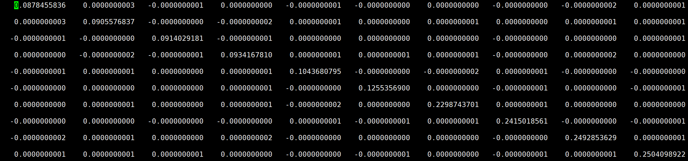

    如图所示的 `0_Ham_re` 文件,对角项为 KS 轨道的本征能量,非对角项为 0。


2. **非绝热耦合项** $-i\hbar \dot{\mathbf R} \cdot \mathbf{d}_{kj}$:原子核运动越快、或基函数随位置变化越剧烈,电子态之间的跃迁概率就越大,方向沿着电子云的改变方向。下标 $k, j$ 的顺序不能随意改变。

---

### 5、引入密度矩阵

根据前面的推导可以得到 $\dot{c}_k$,但这个形式只能表示单一态 $k$ 的变化(纯态),且初始条件需要确定。一般来说电子的初始情况是不确定的(可能是纯态,也可能是混合态),因此需要引入密度矩阵来讨论更一般的情况。

密度矩阵定义为:

$$ a_{kj} = c_k c_j^* =  \begin{pmatrix}c_{kk} & c_{kj} \\c_{jk} & c_{jj}\end{pmatrix} = \begin{pmatrix}|c_k|^2 & c_k c_j^* \\c_j c_k^* & |c_j|^2\end{pmatrix} \tag{17} $$

其中:

- **对角元** $a_{kk} = |c_k|^2$:与 $|c_k|^2$ 物理含义相同,表示态 $k$ 的布居数。
- **非对角元** $a_{kj}$:表示态 $j$ 和 $k$ 之间的相干项(复数)。

> **例**:波函数 $\Psi = c_1\psi_1 + c_2\psi_2$,计算其 $|\Psi|^2$:
>
> $$
> \begin{aligned}
> \Psi^* \Psi &= (c_1\psi_1 + c_2\psi_2)^* \cdot (c_1\psi_1 + c_2\psi_2) \\
> &= (c_1^*\psi_1^* + c_2^*\psi_2^*) \cdot (c_1\psi_1 + c_2\psi_2)
> \end{aligned}
> $$
>
> $$
> |\Psi|^2 = \underbrace{|c_1|^2|\psi_1|^2 + |c_2|^2|\psi_2|^2}_{\text{经典概率}} + \underbrace{c_1 c_2^* \psi_1 \psi_2^* + c_1^* c_2 \psi_1^* \psi_2}_{\text{量子耦合}}
> $$

同样地,我们需要计算密度矩阵 $a_{kj}$ 的概率流 $\dot{a}_{kj}$:

$$
\dot{a}_{kj} = \frac{d}{dt}(c_k c_j^*) = \dot{c}_k c_j^* + c_k \dot{c}_j^* \tag{18}
$$

上式 (18) 中出现了 $\dot{c}_j^*$,因此先把式 (16) 的复共轭(并把求和指标改为 $l$,$j \to l$)写出,再把 $k$ 换成 $j$ 以得到 $\dot{c}_j^*$:

$$
-i\hbar \dot{c}_j^* = \sum_l c_l^* \left( V_{jl}^* + i\hbar \dot{\mathbf R} \cdot \mathbf{d}_{jl}^* \right) \tag{19}
$$

> **说明**:计算非绝热耦合项的复共轭满足 $d_{kj}^* = -d_{jk}$,即非绝热耦合是**反厄米的**(对实数基函数情形可简化为 $d_{kj} = -d_{jk}$)。
>
> **证明**:考虑 $\nabla_R \langle \phi_k | \phi_j \rangle = 0$(正交归一对所有 $R$ 成立),由乘积求导:
>
> $$
> \langle \nabla_R \phi_k | \phi_j \rangle + \langle \phi_k | \nabla_R \phi_j \rangle = 0
> \;\Rightarrow\; \langle \nabla_R \phi_k | \phi_j \rangle + d_{kj} = 0
> $$
>
> 又因为 $\langle A | B \rangle = \langle B | A \rangle^*$,有 $\langle \nabla_R \phi_k | \phi_j \rangle = \langle \phi_j | \nabla_R \phi_k \rangle^* = d_{jk}^*$,故 $d_{jk}^* + d_{kj} = 0$,即 $d_{kj} = -d_{jk}^*$。证毕。
>
> 因此当 $k=j$ 时 $d_{kk} = -d_{kk}^*$,即 $d_{kk}$ 为纯虚数;在实基(Γ 点等情形)下 $d_{kk}=0$。
>
> 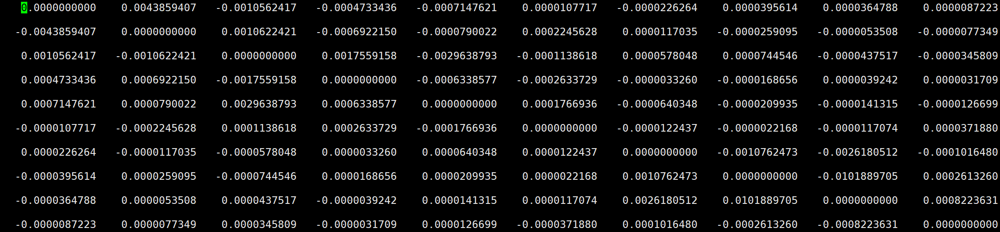
>
> 如图所示的 `0_Ham_im` 文件,对角项为 0,非对角项为非绝热耦合项,且 $(k,j)$ 与 $(j,k)$ 两个非对角元在实基下互为相反数。

> **注意**:该证明结论写作 $d_{jk} + d_{kj} = 0$,严格上应为 $d_{jk}^* + d_{kj} = 0$;只有当波函数取实数(或选定 gauge 使 NAC 实数化)时才有 $d_{jk} = -d_{kj}$。

将 (16) 式和 (19) 式代入 (18),可得:

$$
\dot{a}_{kj} = \left[ \frac{1}{i\hbar} \sum_l c_l (V_{kl} - i\hbar \dot{\mathbf R} \cdot \mathbf{d}_{kl}) \right] c_j^* + c_k \left[ -\frac{1}{i\hbar} \sum_l c_l^* (V_{jl}^* + i\hbar \dot{\mathbf R} \cdot \mathbf{d}_{jl}^*) \right] \tag{20}
$$

> **注意**:由于 $j, k$ 已经表达了不同电子态,求和指标更换为 $l$,原意不变。

将 $\dfrac{1}{i\hbar}$ 和求和符号全部提出:

$$
\dot{a}_{kj} = \frac{1}{i\hbar} \sum_l \left\{ c_l c_j^* (V_{kl} - i\hbar \dot{\mathbf R} \cdot \mathbf{d}_{kl}) - c_k c_l^* (V_{jl}^* + i\hbar \dot{\mathbf R} \cdot \mathbf{d}_{jl}^*) \right\} \tag{21}
$$

其中 $a_{lj} = c_l c_j^*$,$a_{kl} = c_k c_l^*$,因此上式写为:

$$
\dot{a}_{kj} = \frac{1}{i\hbar} \sum_l \left\{ a_{lj} (V_{kl} - i\hbar \dot{\mathbf R} \cdot \mathbf{d}_{kl}) - a_{kl} (V_{jl}^* + i\hbar \dot{\mathbf R} \cdot \mathbf{d}_{jl}^*) \right\} \tag{22}
$$

> **说明**:电子哈密顿量 $H_{ij}$ 是厄米的,即 $H_{ij} = H_{ji}^*$(转置取复共轭保持不变)。对角项为本征能量,非对角项为非绝热耦合;因为非绝热耦合是反厄米的,所以可以证明哈密顿量是厄米的。
>
> **证明**:对于仅含有两个态 $1,2$ 的系统,哈密顿量写作
>
> $$
> H = \begin{pmatrix}
> H_{11} & H_{12} \\
> H_{21} & H_{22}
> \end{pmatrix} = \begin{pmatrix}
> \epsilon_1 & -i\hbar d_{12} \\
> -i\hbar d_{21} & \epsilon_2
> \end{pmatrix}
> $$
>
> - **对角元**:本征能量 $\epsilon_1, \epsilon_2$ 为实数,不变。
> - **非对角元**:$(-i\hbar d_{12})^* = i\hbar d_{12}^* = -i\hbar d_{21}$(利用 $d_{12}^* = -d_{21}$);转置后正好对应另一个非对角元。
> - **结论**:$H = H^\dagger$,哈密顿量是厄米的。证毕。

因此,可以将式 (22) 中所有的复共轭消除:

$$
\dot{a}_{kj} = \frac{1}{i\hbar} \sum_l \left\{ a_{lj} (V_{kl} - i\hbar \dot{\mathbf R} \cdot \mathbf{d}_{kl}) - a_{kl} (V_{lj} - i\hbar \dot{\mathbf R} \cdot \mathbf{d}_{lj}) \right\} \tag{23}
$$

首先,我们主要关心布居数 $a_{kk}$ 的变化率。令 $j=k$,上式 (23) 可以写作:

$$
\dot{a}_{kk} = \frac{1}{i\hbar} \sum_l \left\{ a_{lk} (V_{kl} - i\hbar \dot{\mathbf R} \cdot \mathbf{d}_{kl}) - a_{kl} (V_{lk} - i\hbar \dot{\mathbf R} \cdot \mathbf{d}_{lk}) \right\} \tag{24}
$$

当 $l=k$ 时上式被求和项内部相抵消(对 $\dot{a}_{kk}$ 无贡献),因此求和只需考虑 $l \neq k$ 的情况:

$$
\dot{a}_{kk} = \frac{1}{i\hbar} \sum_{l \neq k} \left\{ a_{lk} (V_{kl} - i\hbar \dot{\mathbf R} \cdot \mathbf{d}_{kl}) - a_{kl} (V_{lk} - i\hbar \dot{\mathbf R} \cdot \mathbf{d}_{lk}) \right\} \tag{25}
$$

为了方便,做如下替换:

$$
\dot{a}_{kk} = \sum_{l \neq k} b_{kl} \tag{26}
$$

态 $k$ 布居数的变化率 $\dot{a}_{kk}$ 等于从所有其他态 $l$ 流入态 $k$ 的布居流 $b_{kl}$ 之和。如果 $b_{kl}$ 为正,表示有净流量从 $l$ 流向 $k$。

$$
b_{kl} = \frac{1}{i\hbar} \left[ a_{lk} (V_{kl} - i\hbar \dot{\mathbf R} \cdot \mathbf{d}_{kl}) - a_{kl} (V_{lk} - i\hbar \dot{\mathbf R} \cdot \mathbf{d}_{lk}) \right] \tag{27}
$$

利用 $a_{lk} = a_{kl}^*$ 和 $V_{lk} = V_{kl}^*$ 将上式中的势能项和非绝热耦合项合并。

**(1)势能项**写作:

$$
\frac{1}{i\hbar} (a_{kl}^* V_{kl} - a_{kl} V_{kl}^*) \tag{28}
$$

令 $z = a_{kl}^* V_{kl}$,那么 $z^* = a_{kl} V_{kl}^*$,上式就可以写作:

$$
\frac{1}{i\hbar} (z - z^*) \tag{29}
$$

对于任意复数 $z = x + iy$,$z - z^* = 2iy = 2i\,\text{Im}(z)$。因此式 (29) 又可以写作:

$$
\frac{1}{i\hbar} \cdot 2i\,\text{Im}(z) = \frac{2}{\hbar} \text{Im}(z) \tag{30}
$$

将 $z$ 还原为 $a_{kl}^* V_{kl}$,势能项写作:

$$
\frac{2}{\hbar} \text{Im}(a_{kl}^* V_{kl}) \tag{31}
$$

> **注意**:势能项中我们取出的是虚部上的实数,而不是虚数本身。例如 $a + bi$ 中,$a$ 和 $b$ 都是实数,$bi$ 为虚数,但是我们需要的是 $b$。

**(2)非绝热耦合项**写作:

$$
\frac{1}{i\hbar} \left[ a_{kl}^* (-i\hbar \dot{\mathbf R} \cdot \mathbf{d}_{kl}) - a_{kl} (-i\hbar \dot{\mathbf R} \cdot \mathbf{d}_{lk}) \right] \tag{32}
$$

利用 $d_{lk} = -d_{kl}^*$(反厄米),令 $z = -i\hbar a_{kl}^* \dot{\mathbf R} \cdot \mathbf{d}_{kl}$,则 $z^* = i\hbar a_{kl} \dot{\mathbf R} \cdot \mathbf{d}_{kl}^*$,上式可以写作:

$$
\frac{1}{i\hbar} (z + z^*) \tag{33}
$$

对于任意复数 $z = x + iy$,$z + z^* = 2x = 2\,\text{Re}(z)$。因此式 (32) 又可以写作:

$$
\frac{1}{i\hbar} \cdot 2\,\text{Re}(z) = -2\,\text{Re}(a_{kl}^* \dot{\mathbf R} \cdot \mathbf{d}_{kl}) \tag{34}
$$

最终,我们可以将式 (27) 写作如下形式:

$$
b_{kl} = \frac{2}{\hbar} \text{Im}(a_{kl}^* V_{kl}) - 2\,\text{Re}(a_{kl}^* \dot{\mathbf R} \cdot \mathbf{d}_{kl}) \tag{35}
$$

那么,密度矩阵的布居流可以写成如下形式:

$$
\dot{a}_{kk} = \sum_{l \neq k} \left[ \frac{2}{\hbar} \text{Im}(a_{kl}^* V_{kl}) - 2\,\text{Re}(a_{kl}^* \dot{\mathbf R} \cdot \mathbf{d}_{kl}) \right] \tag{36}
$$

而在绝热基下,哈密顿量的非对角元为 0,即 $V_{kl} = 0$($k \neq l$)。因此,最终的 $\dot{a}_{kk}$ 布居数变化仅仅依赖于非绝热耦合的作用:

$$
\dot{a}_{kk} = -\sum_{l \neq k} 2\,\text{Re}(a_{kl}^* \dot{\mathbf R} \cdot \mathbf{d}_{kl}) \tag{37}
$$


---

### 6、如何发生跃迁

如果要实现最小面跳跃,我们需要做出如下约定:

1. 在发生电子跃迁之前,原子核仅在一个电子态势能面上做经典运动。
2. 允许第 $k$ 个电子态跳跃至其他态 $l$,并且 $k$ 跳跃至不同 $l$ 是独立的,不允许往返跳跃,以保证跳跃次数最少。
3. 当轨迹足够多时,原子核在 $t$ 时刻处在 $k$ 电子态的比例应等于 $a_{kk}$。

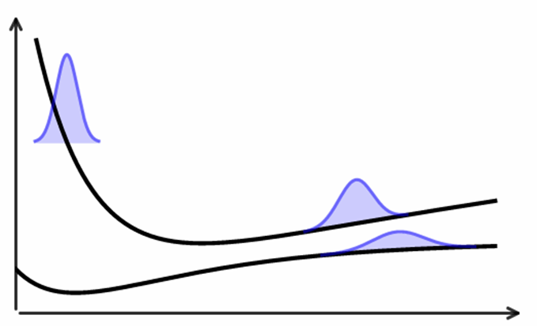

#### 6.1 N 条轨迹

考虑原子核运动共 $N$ 条经典轨迹($N$ 足够大),在 $t$ 时刻处于第 $k$ 个电子态上的轨迹数为 $N_k(t)$。此时轨迹分布比例应为体系处于该电子态的布居数:

$$
N_k(t)/N = a_{kk}(t) = |c_k(t)|^2 \tag{38}
$$

在下一个时刻 $t + \Delta t$,第 $k$ 个电子态的布居数是 $a_{kk}(t+\Delta t)$。假定此时在第 $k$ 个电子态的布居数减少,对于经典轨迹来说,处于 $k$ 电子态的轨迹数变少,即 $N_k(t) > N_k(t+\Delta t)$,此时布居数:

$$
a_{kk}(t) > a_{kk}(t+\Delta t) \tag{39}
$$

在 $\Delta t$ 时间间隔后,从第 $k$ 个电子态离开的几率为:

$$
P_k(t, \Delta t) = \frac{a_{kk}(t) - a_{kk}(t+\Delta t)}{a_{kk}(t)}
\approx -\frac{\Delta t \cdot \dot{a}_{kk}}{a_{kk}(t)}
= -\sum_{l \neq k} \frac{\Delta t \, b_{kl}}{a_{kk}(t)} \tag{40}
$$

其中,从态 $k$ 向单个态 $j$ 跃迁的概率为:

$$
g_{k \to j} = -\frac{\Delta t}{a_{kk}} b_{kj} \tag{41}
$$

单个态的跃迁概率不一定为正(若 $b_{kj} > 0$ 意味着布居净流入 $k$,不应触发由 $k \to j$ 的跳跃),因此取截断:

$$
g_{k \to j} = \max\left(0, \, -\frac{\Delta t}{a_{kk}} b_{kj}\right) \tag{42}
$$

求和所有终态即得 $P_k(t, \Delta t)$:

$$
P_k(t, \Delta t) = \sum_{l \neq k} g_{k \to l} \tag{43}
$$

因此,从 $j$ 态向 $k$ 态的跃迁概率(替换上式中的角色)最后可以写作:

$$
P_{j \to k} = -\frac{2\,\text{Re}(c_j^* c_k \, \mathbf{d}_{jk} \cdot \mathbf{v}) \, \Delta t}{|c_j|^2} \tag{44}
$$

#### 6.2 判断是否跃迁的随机算法

1. **计算所有 $g_{k \to j}$**。
2. **生成 $\xi \in [0, 1)$ 的随机数**。
3. **判断是否跃迁**:

    - 若 $\xi < g_{k \to 1}$,则跃迁到态 1;
    - 否则若 $\xi < g_{k \to 1} + g_{k \to 2}$,则跃迁到态 2;
    - 依此类推,直到找到满足条件的 $j$;
    - 若 $\xi > \sum_j g_{k \to j}$,则保持在当前态 $k$。

#### 6.3 能量守恒与速度调整

- 如果发生了跃迁,则需调整原子核速度以保持总能守恒。
- 调整的核速度方向需要沿着非绝热耦合矢($\mathbf{d}_{jk}$)方向。
- 如果动能调整后依然不能满足能量守恒,那么这次跃迁不发生。

---

## 二、含时密度泛函理论下的面跳跃

### 1、KS 轨道近似

尽管 Tully 教授提出的 FSSH 在非绝热动力学模拟中提供了显著的简化,使其能够处理多种电子激发态之间的跃迁,然而 FSSH 涉及复杂势能面或者较多电子数时(例如凝聚态系统),依然需要计算多个激发态势能面以及非绝热耦合,这使得计算成本非常高昂。

因此,Oleg(Prezhdo)等人通过引入科恩-沈吕九(Kohn–Sham, KS)轨道理论对电子态简化处理,并采用经典路径近似,专注描述电子的动力学过程。

之前我们所讨论,电子波函数 $\Psi(r,R,t)$ 是在绝热基函数 $\phi_i(r;R(t))$ 上展开的,而我们使用的绝热基函数一般是多电子态的。下面我们了解绝热基函数和 KS 轨道的联系。

我们之前讨论过,整个体系的电子波函数可以由绝热基展开,即公式 (3):$\Psi(r,R,t)=\sum_{i}c_{i}(t)\phi_{i}(r;R(t))$。在这之中,如果整个体系的电子波函数包含 $N$ 个电子,那么每个绝热基函数同样需要包含 $N$ 个电子:

$$
\Psi(\mathbf{r}_1, \dots, \mathbf{r}_N, t) = c_1(t) \phi_1(\mathbf{r}_1, \dots, \mathbf{r}_N) + c_2(t) \phi_2(\mathbf{r}_1, \dots, \mathbf{r}_N) + \dots \tag{45}
$$

**说明**:

- 左边的 $\Psi$ 是一个依赖于 $N$ 个独立变量 $(\mathbf{r}_1, \mathbf{r}_2, \dots, \mathbf{r}_N)$ 的函数。
- 如果右边某一项 $\phi_1$ 只包含了 $(\mathbf{r}_2, \dots, \mathbf{r}_N)$,那它只是 $N-1$ 个变量的函数。对于变量 $\mathbf{r}_1$ 而言,它是一个常数。这表明 $\mathbf{r}_1$ 无法描述电子 1。
- 左边 $\Psi$ 的维度为 $N$,对于不包含电子 1 的 $\phi_1$,维数为 $N-1$,我们无法使用 $N-1$ 维的函数构建出一个 $N$ 维的函数。
- 所有的基函数必须包含完全相同数量的电子。一旦有基函数缺少电子,那么维数为 $N-1$ 无法和 $N$ 维的其他基函数做运算(矩阵、向量计算)。

我们现在了解绝热基函数是多电子态的,接下来需要将多电子态使用单电子基再来描述,即 KS 轨道,表明 KS 轨道描述的是单个电子运动的波函数 $\varphi_i(r)$。

为了描述多电子态,绝热基函数 $\Phi_I$ 需要由 $N$ 个选定的 KS 轨道组成的 **Slater 行列式**表示。引入 Slater 行列式是为了满足以下两点要求:

1. 全部电子都是等价的,无法区分。
2. 任意交换两个电子,波函数的符号相反,即 $\phi(r_1, r_2) = -\phi(r_2, r_1)$(量子力学假定 5)。

> **注意**:这里说的"无法区分"指的是可测量的物理量是无法区分的,即 $\langle \Psi | \hat{A} | \Psi \rangle$。对于可测量的物理量 $A$ 来说,其测量的期望值 $\langle A \rangle = \int_{-\infty}^{\infty} A |\Psi(r,t)|^2 \, dr$,其中波函数取了平方,符号改变也不会影响 $A$ 的期望值。

为表述方便,我们一般使用 $\phi = |\varphi_a(1)\varphi_b(2) \dots \varphi_N(N)|$ 表示多电子的 Slater 行列式,即:

$$
|\varphi_a(1)\varphi_b(2) \dots \varphi_N(N)| = \frac{1}{\sqrt{N!}}
\begin{vmatrix}
\varphi_a(1) & \varphi_b(1) & \cdots & \varphi_N(1) \\
\varphi_a(2) & \varphi_b(2) & \cdots & \varphi_N(2) \\
\vdots & \vdots & \ddots & \vdots \\
\varphi_a(N) & \varphi_b(N) & \cdots & \varphi_N(N)
\end{vmatrix}
$$

其中 $\dfrac{1}{\sqrt{N!}}$ 为归一化系数。

考虑一个简单的两电子体系:一个电子在轨道 $\varphi_a$ 上,另一个在轨道 $\varphi_b$ 上。我们可以写成行列式:

$$
\phi(1, 2) = \frac{1}{\sqrt{2}} \begin{vmatrix} \varphi_a(1) & \varphi_b(1) \\ \varphi_a(2) & \varphi_b(2) \end{vmatrix} \tag{46}
$$

上式也可以写作:

$$
\phi(1, 2) = \frac{1}{\sqrt{2}} \left[ \varphi_a(1)\varphi_b(2) - \varphi_b(1)\varphi_a(2) \right] \tag{47}
$$

其中每一项的系数平方相加等于 1,因此满足总概率为 1。如果交换两个电子,式 (47) 变为:

$$
\phi(2, 1) = \frac{1}{\sqrt{2}} \left[ \varphi_a(2)\varphi_b(1) - \varphi_b(2)\varphi_a(1) \right] \tag{48}
$$

与式 (47) 差一个负号。

> **注意**:这里并没有取复共轭,也没有算符,因此 $\varphi_a(2)\varphi_b(1)$ 可以交换顺序。

使用 Slater 行列式可以极大降低计算量,能够使所有电子的 $3N$ 维空间积分变成只针对变化的电子的三维积分。

> **示例(两电子体系的非绝热耦合)**:
>
> - 考虑最简单的两电子体系,此时有三个 KS 轨道 $\varphi_A, \varphi_B, \varphi_C$,它们是正交归一的。
> - 初态 $\phi_{\text{in}}$:电子占据 $\varphi_A$ 和 $\varphi_B$。
> - 末态 $\phi_{\text{out}}$:电子占据 $\varphi_A$ 和 $\varphi_C$(电子从 $B$ 轨道跳跃到了 $C$ 轨道,$A$ 不变)。
> - 此时计算其非绝热耦合,由之前的推导可得非绝热耦合的算符为 $\dfrac{\partial}{\partial t}$。
> - 非绝热耦合算符为单体算符,需要对两个电子分别作用,即总算符 $\hat{O} = \hat{o}(1) + \hat{o}(2)$,其中 $\hat{o}(1) = \hat{o}(2) = \dfrac{\partial}{\partial t}$。
> - 因此,总的非绝热耦合 $d_{IO} = \langle \phi_{\text{in}} | \hat{O} | \phi_{\text{out}} \rangle$。
>
> 我们将初态和末态写成 Slater 行列式展开:
>
> $$
> \phi_{\text{in}} = \frac{1}{\sqrt{2}} [\varphi_A(1)\varphi_B(2) - \varphi_B(1)\varphi_A(2)]
> $$
>
> $$
> \phi_{\text{out}} = \frac{1}{\sqrt{2}} [\varphi_A(1)\varphi_C(2) - \varphi_C(1)\varphi_A(2)]
> $$
>
> 我们可以得到非绝热耦合形式为
>
> $$
> d_{IO} = \langle \phi_{\text{in}} | \hat{o}(1) + \hat{o}(2) | \phi_{\text{out}} \rangle
> $$
>
> $$
> = \frac{1}{2} \bigl[\langle \varphi_A(1)\varphi_B(2)| - \langle \varphi_B(1)\varphi_A(2)|\bigr] \bigl(\hat{o}(1)+\hat{o}(2)\bigr) \bigl[|\varphi_A(1)\varphi_C(2)\rangle - |\varphi_C(1)\varphi_A(2)\rangle\bigr]
> $$
>
> 将积分写开会有四项乘积,我们只看第一项即可,其他类似。第一项写作
>
> $$
> \langle \varphi_A(1)\varphi_B(2) | \hat{o}(1) + \hat{o}(2) | \varphi_A(1)\varphi_C(2) \rangle
> $$
>
> 其中积分包括两部分,分别对应 $\hat{o}(1)$ 和 $\hat{o}(2)$。
>
> - **计算 $\hat{o}(1)$**:
>
> $$
> \iint dr_1\, dr_2\, [\varphi_A^*(1)\varphi_B^*(2)] \cdot \hat{o}(1) \cdot [\varphi_A(1)\varphi_C(2)]
> $$
>
> 算符 $\hat{o}(1)$ 只对电子 1 有作用,关于电子 2 的函数被视为常数,因此可以移动各项位置(保持 $\hat{o}(1)$ 左侧为 $\varphi_A(1)$):
>
> $$
> \iint dr_1\, dr_2 \left[ \varphi_A^*(1) \hat{o}(1) \varphi_A(1) \right] \left[ \varphi_B^*(2) \varphi_C(2) \right]
> $$
>
> 再使用**微积分基本定理**(被积函数可分离,积分区域不耦合时双重积分等于两个单重积分之积):
>
> $$
> \iint f(x)g(y) \, dx \, dy = \left( \int f(x) \, dx \right) \left( \int g(y) \, dy \right)
> $$
>
> 因此积分写作
>
> $$
> \left( \int dr_1\, \varphi_A^*(r_1)\hat{o}(1)\varphi_A(r_1) \right) \cdot \left( \int dr_2\, \varphi_B^*(r_2)\varphi_C(r_2) \right)
> $$
>
> 因为 $\varphi_B$ 和 $\varphi_C$ 是不同的本征轨道,它们正交,所以 $\langle \varphi_B|\varphi_C\rangle = 0$,即本项为 0。
>
> - **计算 $\hat{o}(2)$**:类似地有
>
> $$
> \left( \int dr_1\, \varphi_A^*(r_1)\varphi_A(r_1) \right) \cdot \left( \int dr_2\, \varphi_B^*(r_2) \hat{o}(2) \varphi_C(r_2) \right)
> $$
>
> 第一部分为 $\langle \varphi_A|\varphi_A\rangle = 1$,因此这项积分变为单电子积分 $\langle \varphi_B|\hat{o}|\varphi_C\rangle$。
>
> 因此,复杂的多体积分能够转化为简单的单体积分:
>
> $$
> d_{IO} = \langle \phi_{\text{in}} | \textstyle\sum_k \hat{o}(k) | \phi_{\text{out}} \rangle = \langle \varphi_B | \hat{o} | \varphi_C \rangle
> $$
>
> 因此,不管 Slater 行列式多么复杂,实际只需要计算单个 KS 轨道之间的非绝热耦合即可。

**以上为 KS 轨道和 Slater 行列式的引入原因。**

因此,式 (12) 所得的时间导数耦合标量 $\langle \phi_k | \frac{\partial}{\partial t} | \phi_j \rangle$ 便可以写作两个不同单电子($p, q$)KS 轨道之间的非绝热耦合:

$$
\left\langle \phi_k \,\middle|\, \frac{\partial}{\partial t} \,\middle|\, \phi_j \right\rangle = \left\langle \varphi_p \,\middle|\, \frac{\partial}{\partial t} \,\middle|\, \varphi_q \right\rangle \tag{49}
$$

此时,非绝热耦合可以通过数值差分方法求解:

$$
d_{pq}(t) = \left\langle \varphi_p(t) \,\middle|\, \frac{\partial}{\partial t} \,\middle|\, \varphi_q(t) \right\rangle \tag{50}
$$

首先,我们将 $t + \Delta t$ 时刻的波函数 $|\varphi_q(t + \Delta t)\rangle$ 在时刻 $t$ 处进行一阶泰勒展开:

$$
|\varphi_q(t + \Delta t)\rangle \approx |\varphi_q(t)\rangle + \Delta t \frac{\partial}{\partial t}|\varphi_q(t)\rangle + O(\Delta t^2) \tag{51}
$$

上式左乘 $\langle \varphi_p(t)|$:

$$
\langle \varphi_p(t) | \varphi_q(t + \Delta t)\rangle \approx \langle \varphi_p(t) | \varphi_q(t)\rangle + \Delta t \left\langle \varphi_p(t) \,\middle|\, \frac{\partial}{\partial t} \,\middle|\, \varphi_q(t) \right\rangle \tag{52}
$$

其中 $O(\Delta t^2)$ 二阶项极小因此忽略;并且 $p \neq q$ 时 $\langle \varphi_p(t) | \varphi_q(t)\rangle = 0$,因此第一项消去。我们就得到了初步近似:

$$
\left\langle \varphi_p(t) \,\middle|\, \frac{\partial}{\partial t} \,\middle|\, \varphi_q(t) \right\rangle \approx \frac{1}{\Delta t} \langle \varphi_p(t) | \varphi_q(t+\Delta t)\rangle \tag{53}
$$

其中 $\langle \varphi_p(t) | \varphi_q(t+\Delta t)\rangle$ 被称为**时间重叠矩阵**(Time-overlap Matrix)。

但是上式并不对称,因为有限时间步长 $\Delta t$ 引入高阶截断误差,从而导致非绝热耦合不是严格反厄米的。因此使用对称修正解决这个问题。考虑另一个方向的重叠:

$$
\langle \varphi_p(t+\Delta t) | \varphi_q(t)\rangle \tag{54}
$$

进行类似的展开:

$$
\left\langle \varphi_q(t) \,\middle|\, \frac{\partial}{\partial t} \,\middle|\, \varphi_p(t) \right\rangle \approx \frac{1}{\Delta t} \langle \varphi_q(t) | \varphi_p(t+\Delta t)\rangle \tag{55}
$$

根据 (53) 和 (55),并利用反厄米性 $d_{qp} = -d_{pq}^*$(实基下即 $d_{qp} = -d_{pq}$),我们有两个近似式:

1. $\Delta t \cdot d_{pq} \approx \langle \varphi_p(t) | \varphi_q(t+\Delta t)\rangle$
2. $\Delta t \cdot d_{pq} \approx -\langle \varphi_p(t+\Delta t) | \varphi_q(t)\rangle$

相加可得:

$$
2\Delta t \cdot d_{pq} \approx \langle \varphi_p(t) | \varphi_q(t+\Delta t)\rangle - \langle \varphi_p(t+\Delta t) | \varphi_q(t)\rangle \tag{56}
$$

现在,我们便求得了 $d_{pq}$,将其代入式 (37);电子哈密顿量矩阵元可以写作 $H_{pq} = -i\hbar d_{pq}$(势能项由于绝热基展开为 0),代入上式可得:

$$
H_{pq}\!\left(t + \frac{\Delta t}{2}\right) = -i\hbar \, \frac{\langle \varphi_p(t) | \varphi_q(t+\Delta t)\rangle - \langle \varphi_p(t+\Delta t) | \varphi_q(t)\rangle}{2\Delta t} \tag{57}
$$

> **注意**:
>
> - 此处使用的是 $\langle \phi_k | \dfrac{\partial}{\partial t} | \phi_j \rangle$,因此并未出现核速度。
> - 分子为不同时刻波函数的重叠矩阵的差。
> - 分母来自对称差分的两次时间步长。
> - 时刻为 $(t + \dfrac{\Delta t}{2})$ 表示计算出的两个时间步的中点。例如计算出 $1\,\text{fs}$ 和 $2\,\text{fs}$ 的电子哈密顿矩阵元后,这个数值被认为是 $1.5\,\text{fs}$ 的数值,以保证数值的稳定性。

---

### 2、经典路径近似(Classical Path Approximation, CPA)

由于凝聚态体系通常较大,电子激发对核运动的影响通常可以被忽略,这就是经典路径近似。采用经典路径近似表明:

1. 原子核轨迹是在基态上计算好的,不再随电子态跳跃而改变。
2. 核速度不再调整,因为轨迹已经固定。

因为不再调整核速度,因此,为了让体系依旧满足**细致平衡**(Detailed Balance),需要引入玻尔兹曼因子对跳跃概率进行缩放。

> **说明**:
>
> - 细致平衡描述的是平衡态下的流量守恒。要求从低能态 $k$ 跳到高能态 $j$ 的总流量,必须等于从 $j$ 跳回 $k$ 的总流量。
> - 在热平衡下,状态的概率由玻尔兹曼分布给出:
>
> $$
> \frac{P_k}{P_j} = \frac{e^{-E_k/k_BT}}{e^{-E_j/k_BT}} = e^{(E_j - E_k)/k_BT}
> $$
>
> - 采用 CPA 后,原子核不再对电子能量的变化做出反应。而在标准 FSSH 中,向上跃迁(吸收能量)需要原子核动能改变以保证总能量守恒;如果动能不足以支付跃迁的能垒,就不会跳跃,从而维持平衡。
> - CPA 以后,相当于向上跃迁不再需要能垒,因此向上跃迁(吸收能量)和向下跃迁(放出能量)将由同样的耦合强度驱动,概率几乎相等。这将导致长时间演化后,所有态会有相同的布居数,即 $P_k/P_j = 1$,对应于 $T = \infty$。因此需要使用玻尔兹曼因子对向上跃迁进行抑制。

修正后的跃迁概率公式:

$$
g_{k \to j}^{\text{CPA}} = g_{k \to j}^{\text{FSSH}} \times b_{k \to j}(t) \tag{58}
$$

- 向下跃迁:

    $$
    b_{k \to j} = 1 \tag{59}
    $$

    表明向下跃迁(放出能量)不会受到限制。

- 向上跃迁:

    $$
    b_{k \to j} = \exp\!\left( -\frac{E_j - E_k}{k_B T} \right) \tag{60}
    $$

    表明向上跃迁(吸收能量)被指数抑制,抑制程度取决于能级差和温度。

---

### 3、量子退相干修正

在量子系统的独立演化过程中,若无外界干扰,量子态之间的相干性能够保持。但当系统受到外部扰动时,量子叠加态会被破坏,导致波函数分支和相位分离,使体系迅速坍缩至某一量子态,即发生退相干。

但是,混合量子-经典的 FSSH 方法将量子态分叉、相干演化与核波包传播替换成"经典轨迹 + 随机跳跃"。在全量子方法中,电子与原子核均进行量子化处理,体系波函数能够保持良好的相干性质。但是在 FSSH 方法中,电子被量子化地处理,而原子核采用经典描述,电子与核波函数之间的量子耦合作用无法被正确地描述,因而天然地具有退相干缺失的算法缺陷。因此,FSSH 无法严格满足量子理论对动量、布居数和相干性的要求。

一般来说,我们认为在 CPA-FSSH 量子-经典混合动力学方法中天然地具有过度相干的问题,这主要来自于以下三个方面:

1. CPA 近似导致原子核轨迹并未依照非绝热跃迁发生分支,电子波函数的相干演化被保持过久,即使已经发生跃迁,电子波函数仍保留之前轨道的信息,核轨迹之间的相干没有被及时破坏,引发过度相干。

2. FSSH 算法通过概率公式决定是否发生跳跃,即式 (44):

    $$
    P_{j \to k} = -\frac{2\,\text{Re}(c_j^* c_k \, \mathbf{d}_{jk} \cdot \mathbf{v})}{|c_j|^2} \Delta t
    $$

    假设已经发生了跃迁,即由 $j$ 态跃迁到了 $k$ 态,但是电子波函数的系数并没有随之坍缩,而是继续连续演化。也就是说,系数 $c_j$ 和 $c_k$ 的数值不会发生突变,依然保留了跳跃前的数值,并继续平滑演变。这样会导致对于原子核部分来说系统已经完全处于跳跃后的 $k$ 态了,但是电子依然是 $j$ 态和 $k$ 态的混合态,违背了量子测量的坍缩原理(测量假设)。在使用上式计算概率时,通常会给 $c_j$ 一个极小值,这使得电子始终处于多态叠加的状态,而不是单一明确的状态,从而引入了非物理的过度相干。

3. 通常我们采用一系列不同的初始条件,形成大量跃迁轨迹的系综,并对系综平均尝试人为地引入不确定度,从而重构量子效应。但这种方法获得的轨迹间的相位关系仍然被保留,不同轨迹之间存在高度相似的演化过程,仍然无法有效引入退相干。

> **说明**:
>
> - 如果电子处于两个态,例如基态(Ground State)和激发态(Excited State)的叠加时,我们可以把波函数写作如下形式:
>
> $$
> \varphi = c_k \phi_k + c_j \phi_j
> $$
>
> - 这里的系数 $c$ 是复数,可以将模和相位分开表示:$c_k = |c_k| e^{i\theta_k}, \; c_j = |c_j| e^{i\theta_j}$。
> - 相位差就是 $\Delta\theta = \theta_k - \theta_j$。
> - 根据式 (17) 下的例子,密度矩阵的非对角元体现了相干性,这里考虑非对角元其中一项:
>
> $$
> c_k c_j^* = |c_k||c_j| e^{i(\theta_k - \theta_j)}
> $$
>
> - 只要 $c_k c_j^* \neq 0$,那么这两个态就存在相位关系,就具有相干性,能够发生量子干涉。
> - 但是,在统计平均下,如果相位差是完全随机的(有时是 $0^\circ$,即 $e^{i0}=1$;有时是 $180^\circ$,即 $e^{i\pi}=-1$),这就导致在时间或系综平均下 $c_k c_j^* \to 0$。此时两个态失去了量子相干性,导致退相干;量子概率退化为经典概率分布,这正是量子测量的基本假设所决定的。

尽管存在**退相干诱导表面跳跃**(Decoherence-Induced Surface Hopping, DISH)等方案能够在面跳跃过程中显式地引入退相干和态坍缩过程,但其结果仍是近似的。不过对于目前的计算资源限制来说,CPA + DISH 修正依然是一座无法逾越的大山。

#### 3.1 随机演化算符

在 DISH 方法中,首先定义了复合时间演化算符 $\tilde{\hat{U}}(t, t_0)$,并引入一个退相干算符 $\hat{L}_{\alpha}(t)$ 和标准含时薛定谔方程演化算符 $\hat{U}(t, t_0)$,其中复合时间演化算符定义为:

$$
\tilde{\hat{U}}(t, t_0) = \prod_{\alpha} \left[ \hat{L}_{\alpha}(t) \right] \hat{U}(t, t_0) \tag{61}
$$

其中:

- $\hat{U}(t, t_0)$:代表标准的含时薛定谔方程演化,产生相干的量子叠加态。
- $\hat{L}_{\alpha}(t)$:代表退相干算符,它随机地将波函数"定位"或"坍缩"到某个绝热基态上。

**时间演化算符**:

- 在和外界没有任何相互作用的孤立系统中,波函数的演化严格遵循含时薛定谔方程,即式 (2):

    $$
    i\hbar \frac{\partial}{\partial t} |\psi(t)\rangle = \hat{H} |\psi(t)\rangle
    $$

- 定义的时间演化算符 $\hat{U}(t, t_0)$ 作用在 $|\psi(t_0)\rangle$ 上能够把波函数从 $t_0$ 时刻转移到 $t$ 时刻,即:

    $$
    |\psi(t)\rangle = \hat{U}(t, t_0) |\psi(t_0)\rangle
    $$

- 需要注意的是,含时薛定谔方程是微分方程,描述的是波函数在某一时刻 $t$ 的变化率;而时间演化算符是积分形式,描述的是波函数到 $t$ 时刻会变成什么样子。特别在数值模拟中,我们已知初始状态 $|\psi(t_0)\rangle$ 以后,含时薛定谔方程告诉我们波函数如何变化,但时间演化算符才能直接计算出下一时刻的波函数 $|\psi(t)\rangle$。
- 我们将时间演化算符代入含时薛定谔方程,得到:

    $$
    i\hbar \frac{\partial}{\partial t} \left( \hat{U}(t, t_0) |\psi(t_0)\rangle \right) = \hat{H} \left( \hat{U}(t, t_0) |\psi(t_0)\rangle \right)
    $$

- 此时,$|\psi(t_0)\rangle$ 与时间无关,两边可以直接把它约掉,得到算符的微分方程:

    $$
    i\hbar \frac{d}{dt} \hat{U}(t, t_0) = \hat{H} \hat{U}(t, t_0)
    $$

- 把常数移到右边可得:

    $$
    \frac{d}{dt} \hat{U}(t, t_0) = -\frac{i}{\hbar} \hat{H} \hat{U}(t, t_0)
    $$

- 算符 $\hat{U}(t, t_0)$ 在求导后等于它本身,因此其解为指数形式:

    $$
    \hat{U}(t, t_0) = e^{-i\hat{H}(t - t_0)/\hbar}
    $$

- 时间演化算符属于幺正算符,即 $\hat{U}^\dagger \hat{U} = \hat{U} \hat{U}^\dagger = \hat{I}$(其中 $\hat{I}$ 为单位算符)。将时间演化算符作用在波函数上以后,只改变波函数的相位而不改变模长。这种演化会长时间保持系统的相干性。因此,我们需要在时间演化算符作用下让波函数在有相干性的动力学过程中发生演化,再由退相干算符介入打破相干性,从而实现退相干。

**退相干算符**:

- 退相干算符 $\hat{L}_k(t)$ 是一个随机算符,其具体形式取决于一个均匀分布的随机数 $\zeta \in [0, 1]$ 与当前量子态在态 $k$ 上的概率 $|c_k|^2$ 的比较结果,定义如下:

    $$
    \hat{L}_k(t) =
    \begin{cases}
    \dfrac{\hat{P}_k}{\|\hat{P}_k |\psi\rangle\|}, & \text{若 } \zeta \le |c_k|^2 \;(\text{坍缩到态 } k) \\[6pt]
    \dfrac{\hat{I} - \hat{P}_k}{\|(\hat{I} - \hat{P}_k) |\psi\rangle\|}, & \text{若 } \zeta > |c_k|^2 \;(\text{将态 } k \text{ 投影出去})
    \end{cases}
    $$

- 其中 $\hat{P}_k = |\phi_k\rangle\langle\phi_k|$ 是向绝热基态 $k$ 的投影算符。分母为归一化因子,确保作用后波函数的模长为 1。
- 在之前的推导中,我们提到过需要将态进行投影从而得到某个态的系数变化率。但是这里我们需要的是演化后的一个新的态,而不是数值,因此需要使用投影算符 $\hat{P}_k = |\phi_k\rangle\langle\phi_k|$ 作用在一个态上以产生一个新的态。
- 例如,假设 $|\psi\rangle = c_1 |\phi_1\rangle + c_2 |\phi_2\rangle$,将投影算符 $\hat{P}_1 = |\phi_1\rangle\langle\phi_1|$ 作用在上面:

    $$
    \hat{P}_1 |\psi\rangle = (|\phi_1\rangle\langle\phi_1|) |\psi\rangle = c_1 |\phi_1\rangle
    $$

    这样我们就通过投影算符得到了一个新的波函数,这个波函数保留了原来的振幅信息 $c_1$,但方向被强行改变到了基函数 $|\phi_1\rangle$ 的方向上。这正是"波函数坍缩"的数学定义。

- 但是随之而来的问题是,在投影到 $|\phi_1\rangle$ 方向之后,概率不再守恒。例如波函数为 $|\psi\rangle = 0.6|\phi_1\rangle + 0.8|\phi_2\rangle$,此时总概率为 $|0.6|^2 + |0.8|^2 = 1$;在不归一化的情况下使用投影算符 $\hat{P}_1$ 后:

    $$
    \hat{P}_1 |\psi\rangle = 0.6|\phi_1\rangle
    $$

    此时新波函数的模长平方是 $|0.6|^2 = 0.36$,这意味着粒子只剩下 $36\%$ 的概率存在,另外 $64\%$ 凭空消失。因此除以模长 $0.6$ 进行归一化后,才能使得新波函数在 $|\phi_1\rangle$ 上的概率为 1。

- 退相干算符不是幺正算符,因此上式才使用归一化。它会随机将波函数坍缩到某个绝热基态上。
- 上面投影算符的式子表明:
    - 如果随机数小于概率 $\zeta \le |c_k|^2$,则投影算符作用在波函数上,使波函数变为纯态 $|\psi\rangle = |\phi_k\rangle$,不再和其他态存在相干性;
    - 如果 $\zeta > |c_k|^2$,则将态 $k$ 投影出去,使其不再存在于波函数中,轨迹会根据剩余态的相对概率跳跃到其他某个态上(因为此时我们已经得知不在 $k$ 态上,为了符合测量导致态发生坍缩的投影假设,波函数中属于态 $k$ 的成分必须消失)。

#### 3.2 退相干时间

DISH 需要计算退相干时间从而判断叠加态能维持多久,退相干时间由下式决定:

$$
\frac{1}{\tau_k(t)} = \sum_{j \neq k}^{N} |c_j(t)|^2 \, r_{kj} \tag{62}
$$

其中:

- $r_{kj}$:态 $k$ 和态 $j$ 之间的纯去相速率,可以由光学响应理论或冻结高斯近似等公式预先计算或在线计算。
- $|c_j(t)|^2$:其他态的布居数。

式 (62) 表明:如果波函数主要处于态 $k$ 上,那么其他态的布居数接近 0,此时退相干时间接近 $\infty$,能够一直稳定在态 $k$ 上;如果其他态叠加程度高,退相干则发生得越快。

纯去相速率使用光学响应理论表示。计算可以得到光学响应函数,或者叫得更熟悉一点——**重叠积分** $J_{jk}(t)$。重叠积分的模值衰减速率就是纯去相速率。

$$
J_{jk}(t) = \langle \psi_j(t) | \psi_k(t) \rangle \tag{63}
$$

> **注意**:我们一般说的 $\langle \psi_j | \psi_k \rangle = 0$ 指的是同一时刻、同一哈密顿量下的电子基函数是正交的。上面的重叠积分描述的是同一个核初态在两个不同势能面上演化得到的核波包之间的重叠程度,即原子核分别在势能面 $k$ 和势能面 $j$ 上演化,在时间 $t$ 时,两条核轨迹长得有多像。

式 (63) 一般采用 CPA 后进行统计平均。这两个波函数在一开始会处于同一个初态 $|\psi_0\rangle$,然后随时间演化后发生态之间的差异:

$$
J_{jk}(t) = \langle \psi_j(t) | \psi_k(t) \rangle = \langle \psi_0 | e^{i\hat{H}_j t / \hbar} e^{-i\hat{H}_k t / \hbar} | \psi_0 \rangle \tag{64}
$$

其中 $\hat{H}_j$ 是当电子处于态 $j$ 时的原子核哈密顿量(动能和势能),因为 $J_{jk}(t)$ 描述的是原子核在不同势能面上的重叠程度,这里的哈密顿量是核哈密顿量。

在 CPA 近似下,式 (64) 中的原子核哈密顿量算符可以直接得到具体的数值,因为核轨迹 $R(t)$ 已经被确定,因此可以直接替换成某一时刻的标量函数:

$$
\hat{H}_k \approx E_k(R(t)) \tag{65}
$$

因此,式 (64) 可以替换为:

$$
e^{-i\hat{H}_k t / \hbar} \to \exp\!\left[ -\frac{i}{\hbar} \int_0^t E_k(\mathbf{R}(\tau)) \, d\tau \right] \cdot \langle \psi_0 | \psi_0 \rangle \tag{66}
$$

将式 (66) 代入式 (64),可得:

$$
J_{jk}(t) \approx \left\langle \exp\!\left[ \frac{i}{\hbar} \int_0^t E_j(\tau) \, d\tau \right] \exp\!\left[ -\frac{i}{\hbar} \int_0^t E_k(\tau) \, d\tau \right] \right\rangle \tag{67}
$$

$$
J_{jk}(t) \approx \left\langle \exp\!\left[ -\frac{i}{\hbar} \int_0^t \left( E_k(\tau) - E_j(\tau) \right) d\tau \right] \right\rangle \tag{68}
$$

令 $\Delta E_{jk}(\tau) = E_k(\tau) - E_j(\tau)$,那么:

$$
J_{jk}(t) \approx \left\langle \exp\!\left[ -\frac{i}{\hbar} \int_0^t \Delta E_{jk}(\tau) \, d\tau \right] \right\rangle_T \tag{69}
$$

因为我们需要对大量初始位置和动量平均,因此引入了外面的尖括号 $\langle \cdots \rangle_T$,表示对多条轨迹取平均。

上式计算依旧复杂,通常使用二阶累积量展开近似。首先计算两条电子态之间的能级差 $\Delta E_{jk}$ 相对于平均值的涨落:

$$
\delta U(t) = \Delta E_{jk}(t) - \langle \Delta E_{jk} \rangle \tag{70}
$$

然后计算能隙涨落的非归一化自相关函数(Unnormalized Autocorrelation Function, unACF):

$$
C_{un}(t) = \langle \delta U(t) \, \delta U(0) \rangle \tag{71}
$$

上式反映的是环境对电子能级位置影响持续多久,通常会随时间衰减。将自相关函数进行双重时间积分,直接得到响应函数的衰减形式:

$$
J_{jk}(t) \approx \exp\!\left[ -\frac{1}{\hbar^2} \int_0^t d\tau_2 \int_0^{\tau_2} d\tau_1 \, \langle \delta U(\tau_1) \, \delta U(0) \rangle \right] \tag{72}
$$

> **注意**:由于字母 $t$ 在之前使用过,这里使用 $\tau$ 作为积分变量,以避免符号冲突。

现在我们获得了 $J_{jk}(t)$,求高斯拟合便可以获得纯去相速率。这种方法将复杂的量子相互作用环境用能级差来表示。最后,我们将得到的纯去相速率代回 (62),便能得到退相干时间。

#### 3.3 随机判断退相干事件

在 DISH 方法中,使用泊松过程来判断是否退相干。首先根据之前的步骤计算退相干时间,设为 $\tau_k$,它代表了在当前环境下,态 $k$ 平均能维持多久的相干性。

生成一个随机数 $T$,代表在这次随机当中,允许叠加态存活的时间。如果当前时间演化算符所演化的时间(距离上一次退相干过去的时间)超过了随机生成的寿命,那么立刻使用退相干算符对波函数进行坍缩或者投影移除态 $k$——这就是 DISH 算法中发生跃迁的时刻。如果没有超过,那么波函数继续根据时间演化算符进行演化,到下一个时间步长再判断。

这两种结果取决于量子概率 $|c_k|^2$:

1. **坍缩到 $k$ 态**:概率为 $|c_k|^2$。此时波函数变为纯态 $|\psi\rangle = |\phi_k\rangle$;如果当前势能面不为 $k$ 态的势能面,则发生跳跃,跳到 $k$ 态势能面上。
2. **将 $k$ 态投影出去**:概率为 $1 - |c_k|^2$。态 $k$ 的系数设置为 0,波函数在剩余态中重新归一化。如果当前势能面为 $k$ 态的势能面,但是 $k$ 态被投影出去,则必须跳跃到其他态上,跳跃到哪个态上根据剩下态归一化以后相对的概率分布决定。

---

## 三、结论

至此,基本的非绝热载流子动力学理论方法我们就推导完毕了。尽管 FSSH 依然是"经典 + 量子"处理载流子跃迁(例如使用随机数判断是否发生跃迁、对动量进行调整),并且最小面跳跃会将跃迁简化,无法严格满足量子理论对布居数、动量和退相干的一致性条件,但它也是目前能够使用的较为方便的计算载流子寿命的方法。后续会介绍的**泊松化量子动力学**则使量子动力学遵循严格的数学推导并重现量子系统信息,在不讨论原子核量子化的情况下,提供了一种严格量子一致、物理图像清晰、跃迁统计可控的非绝热动力学路径采样框架。

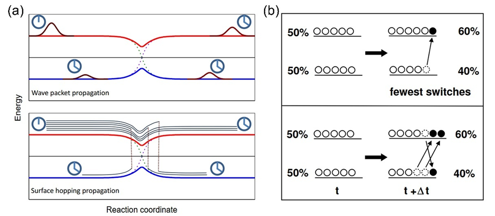

如图所示:

- 图 (a) 为简单避免交叉势能面,在耦合区域随着时间推移应该会发生多次跃迁。
- 图 (b) 为 FSSH 和实际跃迁的差别:本应该跃迁三次的粒子,FSSH 将其简化成了一次。

---

## 四、PYXAID 设置

PYXAID 主要编写为 C++,通过 Python 字典传递参数。

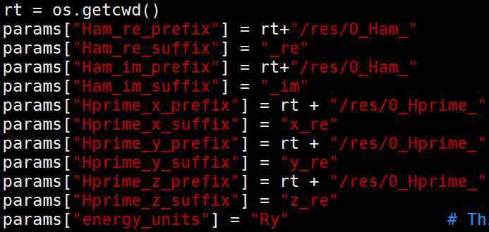

上面这段参数主要读取哈密顿量文件以及其单位。这里设置成 Ry 是因为在从 real 文件转换成哈密顿量文件的时候进行了单位转换;哈密顿量文件实部(`0_Ham_xx_re`)中保存的对角元就是 KS 轨道的能量,单位为 Ry。`Hprime` 则对应跃迁偶极矩,如果包含激光激发则需要使用,这里不涉及。

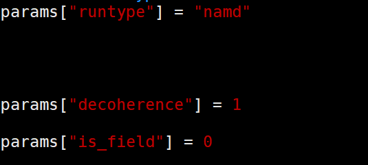

```python
params["runtype"] = "namd"
params["decoherence"] = 1
params["is_field"] = 0
```

- `params["runtype"] = "namd"`:设置为 `namd` 为执行动力学演化,设置为 `no-namd` 不跑动力学,仅检查基组能量。
- `params["decoherence"] = 1`:是否使用 DISH 方法校正。设置为 `0` 表示标准 FSSH,不包含退相干,此时只有时间演化算符 $\hat{U}$ 演化,没有退相干算符 $\hat{L}$ 介入;设置为 `1` 表示开启 DISH 计算,此时会计算退相干时间,并引入退相干算符 $\hat{L}$。
- `params["is_field"] = 0`:是否包含光场激发。`0` 不包含,`1` 包含;如果包含,则会在玻尔兹曼因子分母上引入一个光子能量。

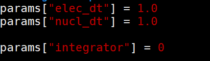

```python
params["elec_dt"] = 1.0
params["nucl_dt"] = 1.0
params["integrator"] = 0
```

- `params["elec_dt"]`:电子积分的时间步长。
- `params["nucl_dt"]`:核积分的时间步长,必须和哈密顿量文件产生时的时间步长保持一致。
- `params["integrator"]`:用什么方法计算积分。

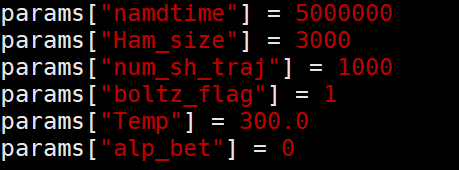

```python
params["namdtime"] = 5000000
params["Ham_size"] = 3000
params["num_sh_traj"] = 1000
params["boltz_flag"] = 1
params["Temp"] = 300.0
params["alp_bet"] = 0
```

- `params["namdtime"] = 5000000`:NAMD 模拟的总时长,5 ns。
- `params["Ham_size"] = 3000`:有多少个哈密顿量文件。如果不足以覆盖总时长,PYXAID 会自行把哈密顿量进行 `ABCDABCD` 首尾相接以补充足够,例如这里仅 3000 个哈密顿量文件,PYXAID 会补充到上面的 5 ns。设置太长会导致计算量过大,PYXAID 无法运行。
- `params["num_sh_traj"] = 1000`:使用多少个轨迹进行平均(总轨迹数 $N$)。如果处于 $k$ 态的轨迹数为 300,那么此时算出的跃迁概率就为 0.3;设置 300–500 均可,设置过多会导致计算量较大。这里采样的是电子的量子跳跃概率,它表示:对于完全相同的原子核初始构型和运动路径,程序会重置随机数种子,尝试 1000 次不同的跳跃可能来判断电子处于 $k$ 态的概率是多少。
- `params["boltz_flag"] = 1`:使用玻尔兹曼因子对向上跃迁的概率进行缩放,如式 (59)、(60) 所示,必须打开。
- `params["Temp"] = 300.0`:使用玻尔兹曼因子缩放时的温度。
- `params["alp_bet"] = 0`:是否考虑自旋耦合,后续再补。

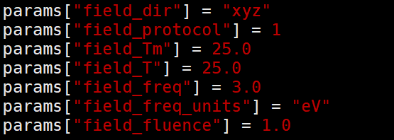

上图均为设置的光场参数,暂不考虑。

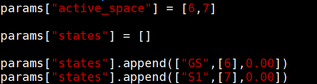

```python
params["active_space"] = [6, 7]
params["states"].append(["GS", [6], 0.00])
params["states"].append(["S1", [7], 0.00])
```

- `params["active_space"] = [6,7]`:设置参与动力学演化的活性空间轨道为 6 和 7。
- `params["states"].append(["GS", [6], 0.00])`:基态轨道为 6,最后一个浮点数可以作为剪刀算子将轨道能量升高或者降低(例如设置 `1` 代表将第 6 号轨道能量增加 1 eV,设置 `-1` 为降低 1 eV),一般在拟合实验带隙时使用。
- `params["states"].append(["S1", [7], 0.00])`:激发态轨道为 7,其他同理。

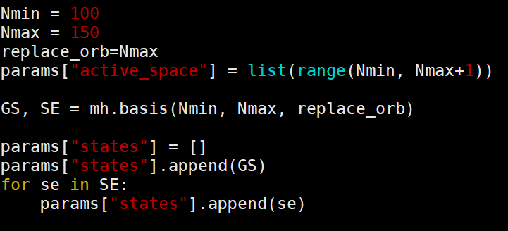

有时也可以写作上面的形式,这时一般考虑的是载流子弛豫而非复合,表示从第 150 个 KS 轨道一直向下演化到第 100 个轨道。

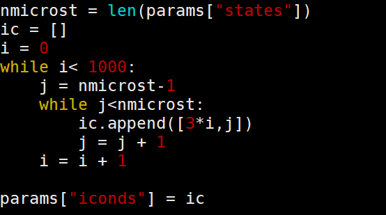

上图为如何生成初始条件。

- `while i < 1000` 表示生成 1000 条独立的随机轨迹来进行系综平均,这里采样的是核的热运动轨迹。
- `j = nmicrost - 1` 表示最后一个电子态的索引,这里给的例子仅有 0 和 1 两个态,因此 `j` 被设置为 1,表示最高激发态。
- `ic.append([3*i, j])` 表示间隔多少步选择核的位置和动量作为 $t = 0$ 时刻;如果没有间隔,那么相邻两条轨迹的原子核构型太过相似,统计相关性太高。间隔选取 3(0, 3, 6, 9, ……)是为了让轨迹的初始构型有足够差异。

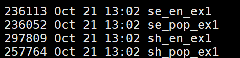

上图为计算结束输出的载流子寿命:

- `sh_pop_ex1`:面跳跃的跃迁概率 $P^{\text{SH}}_k(t) = N_k(t) / N$。
- `se_pop_ex1`:薛定谔方程的跃迁概率 $P^{\text{SE}}_k(t) = |c_k(t)|^2$。

二者没有固定大小关系。`se_en_ex1` 和 `sh_en_ex1` 则是能量演变。

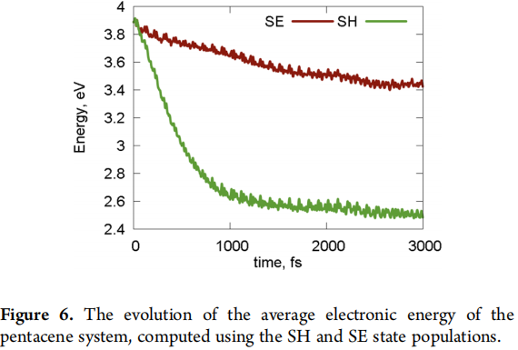

上图就为两种方式计算出的能量演变。

---

## 五、相位修正

实际的计算当中,非绝热耦合计算使用的是式 (57) 计算非绝热耦合,又写作:

$$
d_{jk} \approx \frac{1}{2\Delta t} \left( \langle \varphi_j(t) | \varphi_k(t+\Delta t)\rangle - \langle \varphi_j(t+\Delta t) | \varphi_k(t)\rangle \right) \tag{73}
$$

其中,计算 $t$ 时刻和 $t+\Delta t$ 时刻的波函数相位不一定相同。因为不同相位并不会改变电子云的形状,也不会改变能量。如果有一个波函数 $|\psi\rangle$,它满足下式:

$$
\hat{H} |\psi\rangle = E |\psi\rangle \tag{74}
$$

那么将波函数乘上任意一个相位因子 $e^{i\theta}$(其中 $\theta$ 是任意实数),下式依然成立:

$$
\hat{H} (e^{i\theta} |\psi\rangle) = e^{i\theta} (\hat{H} |\psi\rangle) = e^{i\theta} (E |\psi\rangle) = E (e^{i\theta} |\psi\rangle) \tag{75}
$$

因为电子出现的概率密度为 $P = |\psi|^2$,而 $|e^{i\theta}|^2 = 1$,所以相位因子不会改变电子云的形状,也不会改变能量。

VASP 在每个离子步独立对角化哈密顿量,每次得到的相位 $\theta$ 是随机的。即使让 VASP 在算当前步的时候用上一步的波函数做初猜,但是在自洽迭代的过程中,数值误差累积或者算法收敛路径上有差异,也会导致相位稍有不同。

> **例**:
>
> 1. 简单的 2 能级系统,通过式 (73) 计算非绝热耦合。**在没有相位差的情况下**:
>
> $$
> \psi_1(t) = e^{i0.5\pi} \frac{1}{\sqrt{2}} (1, \, 1)
> $$
>
> $$
> \psi_2(t) = e^{i0.5\pi} \frac{1}{\sqrt{2}} (1, \, -1)
> $$
>
> 相位均为 $0.5\pi$,并且在下一个 $t+dt$ 时刻相位保持不变:
>
> $$
> \psi_1(t+dt) = e^{i0.5\pi} \frac{1}{\sqrt{2}} (1.00, \, 0.98)
> $$
>
> $$
> \psi_2(t+dt) = e^{i0.5\pi} \frac{1}{\sqrt{2}} (0.98, \, -1.02)
> $$
>
> > **注意**:这里为方便计算前面没有将其归一化;实际上应该需要归一化处理再进行后续计算,但目前主要问题是看相位不一致情况下计算出的非绝热耦合,因此这里简化处理。
>
> 根据式 (73),分别计算 $S_{12} = \langle \psi_1(t) | \psi_2(t+dt) \rangle$ 与 $S_{12}' = \langle \psi_1(t+dt) | \psi_2(t) \rangle$。
>
> 先计算第一项:
>
> $$
> \begin{aligned}
> S_{12} &= \left( e^{i0.5\pi} \frac{1}{\sqrt{2}} \begin{pmatrix} 1 \\ 1 \end{pmatrix} \right)^\dagger \cdot \left( e^{i0.5\pi} \frac{1}{\sqrt{2}} \begin{pmatrix} 0.98 \\ -1.02 \end{pmatrix} \right) \\
> &= e^{-i0.5\pi} \cdot e^{i0.5\pi} \cdot \frac{1}{2} \cdot \left( 1\times 0.98 + 1\times(-1.02) \right) \\
> &= \mathbf{-0.02}
> \end{aligned}
> $$
>
> > **注意**:求 $\langle \psi_1(t) | \psi_2(t) \rangle$ 需要先将 $\psi_1(t)$ 求复共轭后再求转置——取复共轭是满足量子力学要求,转置是为了满足线性代数的乘法要求,因此左矢要做共轭转置。
>
> 同理,第二项 $S_{12}' \approx 0.01$。因此 NAC 计算结果(未除 $2\Delta t$)为 $S_{12} - S_{12}' = -0.02 - 0.01 = -0.03$。
>
> 2. 如果在 $t+dt$ 时刻**相位改变**:
>
> $$
> \psi_1(t+dt) = e^{i0.3\pi} \frac{1}{\sqrt{2}} (1.00, \, 0.98)
> $$
>
> $$
> \psi_2(t+dt) = e^{i0.7\pi} \frac{1}{\sqrt{2}} (0.98, \, -1.02)
> $$
>
> - 第一项:
>
> $$
> S_{12} = e^{i(0.7 - 0.5)\pi} \cdot (-0.02) = e^{i0.2\pi} \cdot (-0.02) \approx -0.0162 - 0.0118i
> $$
>
> - 第二项:
>
> $$
> S_{12}' = e^{i(0.5 - 0.3)\pi} \cdot 0.01 = e^{i0.2\pi} \cdot 0.01 \approx 0.0081 + 0.0059i
> $$
>
> - 因此 $S_{12} - S_{12}' \approx -0.0243 - 0.0177i$。

因此,如果不进行相位修正,计算出的不同相位会导致非绝热耦合失去物理意义:实部偏离真值,且出现了本不应该出现的虚部数值噪声。

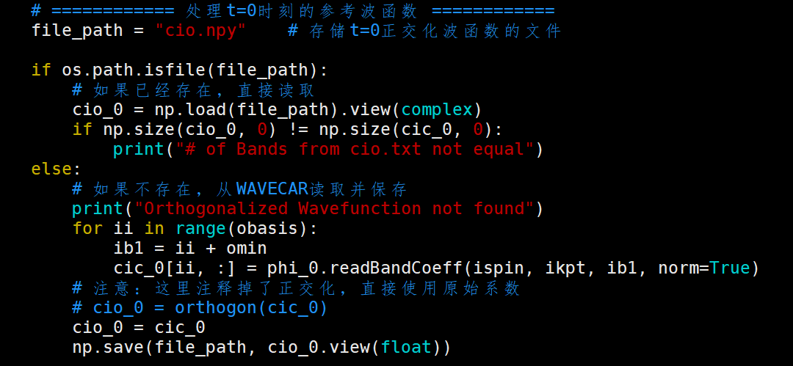

脚本先将 $t=0$ 时刻的波函数 $\psi_{\text{ref}}(0)$ 存储起来,其中包含了随机相位因子 $e^{i\alpha}$,因此:

$$
\psi_{\text{ref}}(0) = \psi_{\text{true}}(0) \cdot e^{i\alpha} \tag{76}
$$

需要修正的 $t$ 时刻波函数设为 $\psi_{\text{now}}(t)$,同样存在一个相位因子 $e^{i\beta(t)}$,因此:

$$
\psi_{\text{now}}(t) = \psi_{\text{true}}(t) \cdot e^{i\beta} \tag{77}
$$

此时需要计算相对的相位因子,即计算重叠积分:

$$
\begin{aligned}
C &= \langle \psi_{\text{ref}} | \psi_{\text{now}}(t) \rangle \\
&= \left( \langle \phi_{\text{true}}(0) | e^{-i\alpha} \right) \cdot \left( |\phi_{\text{true}}(t)\rangle e^{i\beta} \right) \\
&= \langle \phi_{\text{true}}(0) | \phi_{\text{true}}(t) \rangle \cdot e^{i(\beta - \alpha)}
\end{aligned} \tag{78}
$$

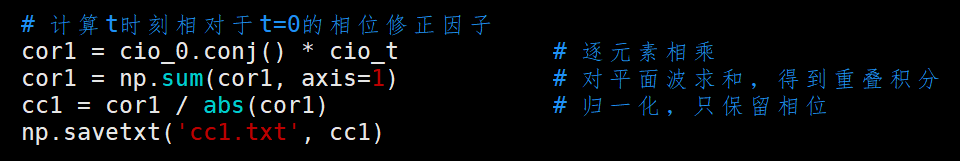

上式即为代码计算中对所有元素相乘并求和:

```python
cor1 = cio_0.conj() * cio_t
cor1 = np.sum(cor1, axis=1)
```

为了得到相对相位因子,还需要除以模长:

$$
P = \frac{C}{|C|} = \frac{\langle \phi_{\text{true}}(0) | \phi_{\text{true}}(t) \rangle}{\bigl| \langle \phi_{\text{true}}(0) | \phi_{\text{true}}(t) \rangle \bigr|} e^{i(\beta - \alpha)} \tag{79}
$$

```python
cc1 = cor1 / abs(cor1)
```

上式即为:

$$
\text{cc1} = e^{i(\beta - \alpha)} \tag{80}
$$

对原始的 $\psi_{\text{now}}(t)$ 乘以 $P^*$ 即可得到相位修正完成后的 $\psi_{\text{corr}}(t)$:

$$
|\psi_{\text{corr}}(t)\rangle = \left( |\phi_{\text{true}}(t)\rangle e^{i\beta} \right) \cdot e^{-i\beta} \cdot e^{i\alpha} = |\phi_{\text{true}}(t)\rangle \cdot e^{i\alpha} \tag{81}
$$

可以看出尽管依然带有随机相位,但是此时的相位已经变成了 $e^{i\alpha}$,在 $t$ 与 $t+\Delta t$ 的内积中会全部抵消,因此相位修正结束。同理,对 $t+dt$ 时刻的波函数进行修正即可。

以上便为相位修正的原理。

---

## 六、全电子校正

---

## 七、附录:所需量子力学基础

### 1、波函数假设

#### 1.1 量子系统的状态描述

量子系统的状态由一个**波函数** $\Psi(\mathbf{r}, t)$ 完全描述:

$$
\Psi(\mathbf{r}, t)
$$

即波函数代表了在任何给定时间 $t$ 时粒子的空间分布。

#### 1.2 统计诠释

波函数的模平方给出粒子在位置 $\mathbf{r}$ 处出现的**概率密度**:

$$
P(\mathbf{r}, t) = |\Psi(\mathbf{r}, t)|^2 = \Psi^*(\mathbf{r}, t) \, \Psi(\mathbf{r}, t)
$$

其中:

- $P(\mathbf{r}, t)$:在 $t$ 时刻、在 $\mathbf{r}$ 位置发现粒子的概率密度。
- $\Psi^*(\mathbf{r}, t)$:$\Psi(\mathbf{r}, t)$ 的复共轭(虚部取反,即 $z = a + bi$ 的复共轭为 $z^* = a - bi$)。

上式又称为波函数的统计诠释。更精确的表达:

$$
P(t) = \int_a^b |\Psi(x, t)|^2 \, dx
$$

表示在 $t$ 时刻发现粒子处于 $a$ 和 $b$ 之间的几率。

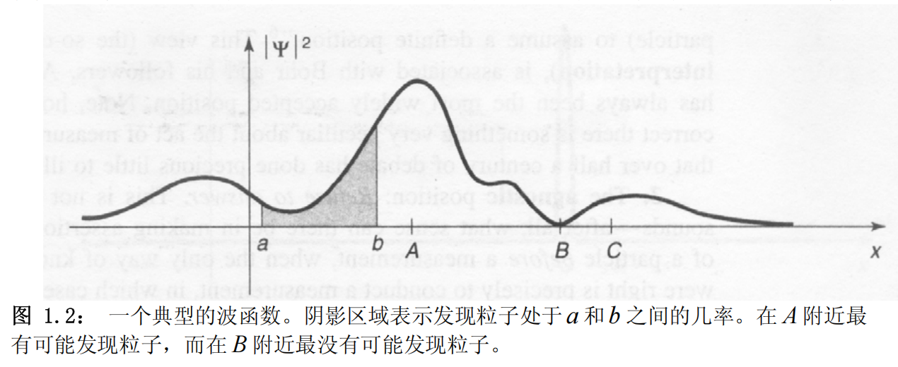

#### 1.3 归一化条件

总概率必须为 1:

$$
\int_{-\infty}^{\infty} |\Psi(\mathbf{r}, t)|^2 \, d^3\mathbf{r} = 1
$$

即在整个空间中一定能找到由 $\Psi$ 表示的粒子,在全空间中找到它的概率为 1。

---

### 2、算符假设

#### 2.1 每个可观测量对应一个厄米算符

物理可观测量(如位置、动量、能量等)都对应于希尔伯特空间中的一个线性厄米算符。因为厄米算符保证了其本征值(测量结果)均为实数。

- 位置算符:$\hat{x} = x$
- 动量算符:$\hat{p} = -i\hbar \nabla$

#### 2.2 本征值方程

$$
\hat{A}\psi_n = a_n \psi_n
$$

其中 $a_n$ 是算符 $\hat{A}$ 的本征值,$\psi_n$ 是对应的本征态。

---

### 3、测量假设

对可观测量 $\hat{A}$ 的测量只能得到其本征值之一。

若系统处于状态 $\Psi$,测量得到本征值 $a_n$ 的概率为:

$$
P(a_n) = |\langle \psi_n | \Psi \rangle|^2
$$

测量后,系统状态坍缩到对应的本征态:

$$
\Psi \xrightarrow{\text{测量}} \psi_n
$$

---

### 4、薛定谔方程

#### 4.1 含时薛定谔方程

系统随时间的演化由薛定谔方程描述:

$$
i\hbar \frac{\partial}{\partial t} \Psi(\mathbf{r}, t) = \hat{H} \Psi(\mathbf{r}, t)
$$

其中 $\hat{H}$ 是哈密顿算符。

#### 4.2 定态薛定谔方程

当势能与时间无关:

$$
\hat{H} \psi(\mathbf{r}) = E \psi(\mathbf{r})
$$

薛定谔方程写作:

$$
-\frac{\hbar^2}{2m} \nabla^2 \psi(\mathbf{r}) + V(\mathbf{r}) \psi(\mathbf{r}) = E \psi(\mathbf{r})
$$

---

### 5、全同粒子假设

#### 5.1 交换对称性

全同粒子不可区分,波函数对于粒子交换必须具有确定的对称性。

- **玻色子**:波函数对称

    $$
    \Psi(\mathbf{r}_1, \mathbf{r}_2) = +\Psi(\mathbf{r}_2, \mathbf{r}_1)
    $$

- **费米子**:波函数反对称

    $$
    \Psi(\mathbf{r}_1, \mathbf{r}_2) = -\Psi(\mathbf{r}_2, \mathbf{r}_1)
    $$

#### 5.2 泡利不相容原理

两个费米子不能处于相同的量子态。

---

# 参考文献

1. Tully, J. C. *Molecular dynamics with electronic transitions.* J. Chem. Phys. **1990**, *93*, 1061–1071.
2. Akimov, A. V.; Prezhdo, O. V. *The PYXAID Program for Non-Adiabatic Molecular Dynamics in Condensed Matter Systems.* J. Chem. Theory Comput. **2013**, *9*, 4959–4972.
3. Akimov, A. V.; Prezhdo, O. V. *Advanced Capabilities of the PYXAID Program: Integration Schemes, Decoherence Effects, Multiexcitonic States, and Field-Matter Interaction.* J. Chem. Theory Comput. **2014**, *10*, 789–804.
4. Jaeger, H. M.; Fischer, S.; Prezhdo, O. V. *Decoherence-induced surface hopping.* J. Chem. Phys. **2012**, *137*, 22A545.
5. Griffiths, D. J. *量子力学概论*, 2009.

---
