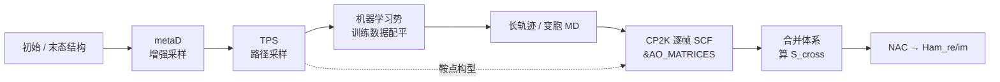

# 从轨迹到 NAC：端到端流程

> 本文说明怎么**拿到一条值得算 NAC 的轨迹**，以及它如何接上 `cp2k/` 下的脚本。适用于任何需要跨越势垒的构型转变——相变、成核、键断裂重排等稀有事件；变胞情形下的基组问题见 [variable-cell-nac.md](variable-cell-nac.md)。

## 0. 全景

三个环节各自解决一个具体的死结，缺一个就卡住：

| 环节 | 解决的问题 | 不做会怎样 |
| --- | --- | --- |
| metaD | 势垒太高，常规 MD 到不了另一侧 | 跑再久也只在初始态附近振荡 |
| TPS | 机器学习势缺少过渡态构型 | 势在鞍点区域不可靠，采样出非物理结构 |
| 局域基组 NAC | 变胞时平面波基组维数不一致 | 内积无定义，NAC 算不出来 |

## 1. 起点：普通 MD 为什么不够

稀有事件的等待时间远超可及的时间尺度。以结构相变为例，即使把机器学习势跑到微秒量级，也未必能观察到一次自发跨越——问题不在势的精度，而在**事件本身的速率**。

因此不能指望"跑一条足够长的 MD 然后挑出转变的那一段"，必须主动施加偏置或直接采样路径。

## 2. 增强采样：metaD

元动力学（metadynamics）的做法是在选定的集体变量（collective variable, CV）上不断沉积高斯型偏置势：

$$
V_{\text{bias}}(\mathbf{s}, t) = \sum_{t' < t} W \exp\!\left[-\frac{\big(\mathbf{s}(t) - \mathbf{s}(t')\big)^2}{2\sigma^2}\right]
$$

偏置势逐渐把沿 CV 的自由能势垒抹平，体系于是在两个盆地之间持续往返；把沉积的偏置势反号累加，就得到自由能面（FES）：

$$
F(\mathbf{s}) \approx -\lim_{t\to\infty} V_{\text{bias}}(\mathbf{s}, t) + \text{const}
$$

**这里有两个关键限制**：

1. **CV 选错，一切白费。** metaD 只在被 CV 张成的子空间里加速。若真实反应坐标不在其中（例如堆垛序列这类不易用少数几个标量描述的自由度），得到的 FES 会误导人。
2. **没有过渡态数据时，结果可能是非物理的。** 偏置会把体系推到势能面未被训练过的区域，机器学习势在那里没有约束，容易生成不合理的构型。这正是下一节要解决的问题。

## 3. 路径采样：TPS

过渡路径采样（transition path sampling）不去改势能面，而是直接在路径空间里做蒙特卡洛，产出**过渡路径的系综**，顺带收获大量鞍点附近的构型。

**打靶（shooting）流程**：

1. 从已有路径（或鞍点、或整条轨迹）上随机取一个构型
2. 给它一个随机速度，向前跑一小段
3. 速度取反，再向后跑一小段
4. 看两条轨迹最终落在哪个盆地——落在不同盆地即"成功打靶"
5. 重复上千次，路径系综逐渐收敛到真实的过渡路径分布

### 变胞体系的关键细节

在允许盒子变形的系综里，时间反演对称性很容易被破坏。正确的做法是：

> **在打靶点令盒子动量为 0，只对原子速度取反。**

这样前向 $(\mathbf{x}, +\mathbf{p})$ 与后向 $(\mathbf{x}, -\mathbf{p})$ 严格互为时间反演，**既允许盒子变形，又保持路径可逆**。如果连盒子动量一起取反，得到的就不是同一条路径的时间反演，细致平衡会被破坏。

### 产出怎么用

- **机制**：由路径系综给出（走哪条通道、经过哪些中间构型）
- **热力学**：自由能势垒交给 metaD，不要从 TPS 直接取
- **训练数据**：TPS 初期给出的路径往往质量一般，但**鞍点附近的构型本身就很有价值**——拿去补充机器学习势的训练集

**工具现状**：USPEX 自带 TPS 功能；LAMMPS 没有现成实现，需要手动赋予并翻转原子动量。

## 4. 机器学习势：训练数据怎么配平

机器学习势的精度取决于训练集覆盖了哪些构型。问题在于：**绝大多数 MD 构型都待在盆地底部，鞍点构型极其稀少**，模型于是在最需要准确的过渡态区域反而最不准。

两种应对，效果不同：

| 做法 | 作用 | 局限 |
| --- | --- | --- |
| 给不同数据集设不同权重 | 提高新数据的采样频率 | **不够**——鞍点构型总数太少，无法覆盖鞍点处原子局域环境的多样性 |
| 直接增加鞍点构型数量 | 从根上补足覆盖 | 依赖 TPS 产出，收集成本高 |

**一个容易踩的坑**：在 DeePMD 里，不同 `system` 在训练中被访问的频率默认与各自的数据量成正比。如果旧数据集很大、新补充的鞍点数据集很小，那么新数据被访问的次数会低到几乎不起作用——模型只是反复复习旧知识。这时候**必须显式调整采样比例**，而不是指望"加进去就会学到"。

## 5. 接上 NAC 计算

拿到变胞轨迹之后：

1. **逐帧 SCF**：每帧跑一次 CP2K 单点，通过 `&PRINT / &AO_MATRICES` 打印 AO 重叠矩阵。模板见 [input.inp](input.inp)。
2. **合并相邻帧**：把 $t$ 与 $t+\Delta t$ 的原子拼成一个 $2N$ 体系，一次 SCF 得到 $S_{\text{cross}}$。详见 [variable-cell-nac.md](variable-cell-nac.md) 第 6 节。
3. **相位对齐**：跨帧 MO 相位必须修正，否则符号乱跳。
4. **算 NAC 并写 Ham**：输出 PYXAID 格式的 `Ham_*_re/im`，交给 FSSH 主程序。

批量驱动见 [cp2k_nac_parallel.sh](cp2k_nac_parallel.sh)；其中 `FRAMES_DIR` 指向帧文件目录、`BMIN/BMAX` 是活性空间窗口（需覆盖占据前沿，HOMO±5 是常用起点）。

## 6. 各步常见坑

| 阶段 | 现象 | 原因 |
| --- | --- | --- |
| metaD | FES 看起来合理但机制与实验不符 | CV 没覆盖真实反应坐标 |
| metaD | 出现原子重叠、键长异常的构型 | 偏置把体系推进了训练集未覆盖的区域 |
| TPS | 打靶成功率极低 | 初始路径太差，或盒子动量处理不当破坏了可逆性 |
| ML 势 | 加了新数据但过渡态精度没提升 | 新旧数据集采样比例失衡，新数据被淹没 |
| CP2K | 重叠矩阵对角 $\lvert S_{ii}\rvert$ 偏离 1 | 帧原子顺序不一致，或读错 `&AO_MATRICES` 段落 |
| CP2K | 活性窗内没有带边，NAC 全是噪声 | `BMIN/BMAX` 没骑在占据前沿上 |

## 7. 边界说明

- 本文是**流程说明**，不是对某个具体体系的推荐参数；CV 选择、偏置高度、TPS 步长都强依赖体系。
- 相变体系的**结构准备**（多型体构建、堆垛序列）本文不涉及。
- metaD / TPS / 机器学习势的具体实现属于各自软件的范畴，本文只说明它们在整条链里的位置与衔接点。
